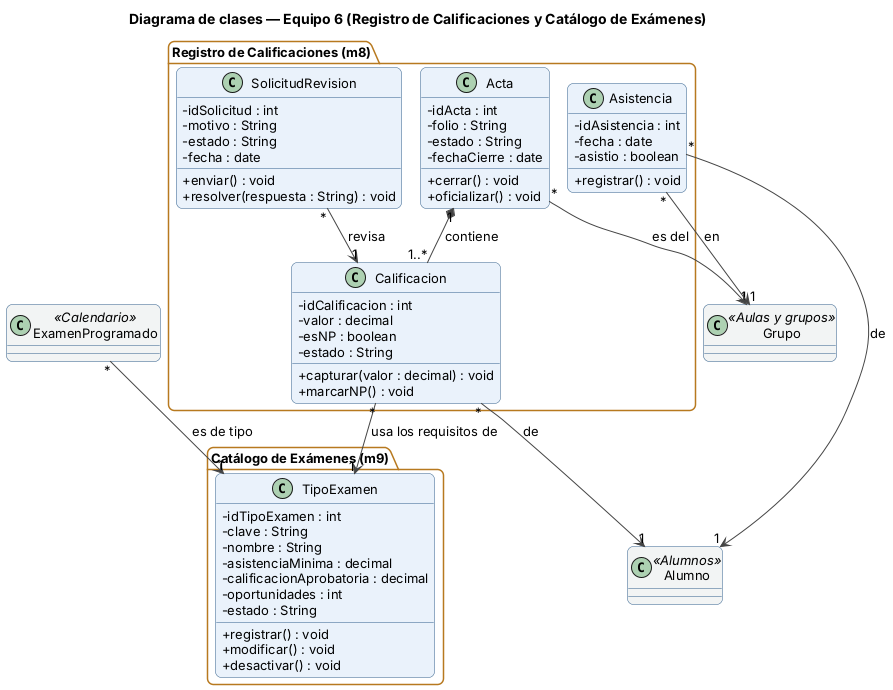

# Proyecto Final

# Tabla de contenido

# I. Introducción

# II. Contexto del proyecto

{TODO diagrama de contexto del proyecto png}

{TODO diagrama de contexto codigo fuente uml - una referencia}

## 2.1. Problemas que se prenden resolver

## 2.2. Oportunidades que buscan aprovechar

# III. Alcance del proyecto

## 3.1 Limites del proyecto

## 3.2 Exclusiones

# IV. Requerimientos

## 4.1 Requerimientos funcionales (RF)

## 4.2 Requerimientos No Funcionales (RNF) 

# V. Modelado del sistema

## 5.1 Diagramas UML (casos de uso, clases, secuencia, etc.)

{TODO - vista general de los modulos - diagrama de herencia de usuarios/roles/actores}

{TODO - vista general de los modulos - diagrama de casos de uso}

{TODO - vista general de los modulos - diagrama de componentes}

### Diagrama de clases — Equipo 6 (Registro de Calificaciones y Catálogo de Exámenes)

El proyecto lleva un solo diagrama de clases. Esta es la parte del Equipo 6: muestra las clases de Registro de
Calificaciones (Acta, Calificacion, Asistencia y SolicitudRevision) y de Catálogo de Exámenes (TipoExamen), con sus
atributos (`-`, privados) y operaciones (`+`, públicas). El rombo negro (composición) indica que las calificaciones no
existen sin su acta. En gris aparecen las clases de otros módulos con las que se conectan (Alumno, Grupo y
ExamenProgramado), para unirlo al diagrama general.

Código fuente: [e6_clases_calificaciones_catalogo.uml](./docs/architecture/diagrams/e6_clases_calificaciones_catalogo.uml)

### Modelo entidad-relación — Equipo 6

Muestra las tablas que guardan los datos de Registro de Calificaciones y Catálogo de Exámenes y cómo se relacionan.
Las tablas en gris (alumno y grupo) pertenecen a otros módulos.

Código fuente: [e6_er_calificaciones_catalogo.uml](./docs/architecture/diagrams/e6_er_calificaciones_catalogo.uml)

## 5.2 Interfaz de usuario (mockups, wireframes)

# Índice de Módulos
-
- [Módulo 2: Inscripciones](./modulos/modulo-inscripciones.md)
- 
- [Módulo 4: Asignaturas/Materias](./modulos/m4_asignaturas.md)

## Autenticación y autorización

{TODO - tabla de aginacion de permisos roles versus modulos}

# Abreviaturas

# Nomenclaturas

# Referencias bibliográficas
