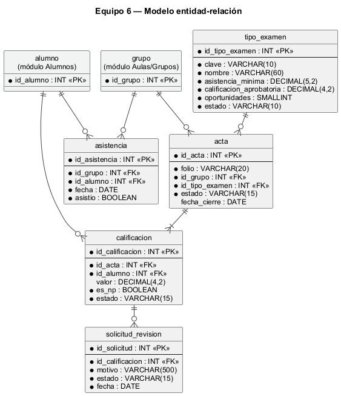

# Proyecto Final

# Tabla de contenido

# I. Introducción

# II. Contexto del proyecto

{TODO diagrama de contexto del proyecto png}

{TODO diagrama de contexto codigo fuente uml - una referencia}

## 2.1. Problemas que se prenden resolver
El presente sistema de control escolar es una herramienta fundamental para la administración de las actividades académicas de una institución educativa.
En el desarrollo de este proyecto buscamos optimizar la organización de la información, la accesibilidad de sus funciones y la interacción con los usuarios, lo que puede complicar la realización de trámites y consultas académicas.

A partir del análisis de desarrollo de un sistema de control escolar, identificamos la oportunidad de desarrollar una alternativa que integre los principales procesos académicos y administrativos de la institución.

Entre los principales problemas que se pretenden atender se encuentran:

**Gestión dispersa de la información**
La administración de datos de alumnos, profesores, asignaturas y periodos académicos requiere una organización centralizada que facilite su consulta y actualización.

**Complejidad en los procesos de inscripción**
La falta de una gestión simplificada de las inscripciones puede dificultar el registro y seguimiento durante los periodo académicos.

**Dificultades en la organización académica**
La administración de calendarios, aulas y asignaturas requiere una coordinación adecuada para evitar inconsistencias y facilitar la planificación de las actividades escolares.

**Seguimiento de evaluaciones y calificaciones**
Es necesario contar con herramientas que permitan administrar los exámenes y consultar los resultados académicos de manera organizada.

**Experienncia de Usuario poco intuitiva**
Una interfaz compleja o poco organizada puede dificultar el acceso a las funciones del sistema, especialmente para usuarios que no tienen experiencia con este tipo de plataformas.

**Falta de Integración entre procesos**
La ausencia de una conexión adecuada entre los diferentes procesos escolares puede generar duplicidad de información y dificultar la administración general de la institución.

Por lo anterior, se propone desarrollar un sistema de control escolar que integre los módulo de Periodos, Alumnos, Profesores, Asignaturas, Calendario, Aulas, Calificaciones, Catálogo de Exámenes e Inscripciones. La finalidad es proporcionar una solución centralizada, organizada y fácil de utilizar, que permita optimizar las gestión académica y administrativa, así como mejorar la experiencia de los usuarios involucrados.

## 2.2. Oportunidades que buscan aprovechar

# III. Alcance del proyecto

## 3.1 Limites del proyecto

## 3.2 Exclusiones

# IV. Requerimientos

## 4.1 Requerimientos funcionales (RF)

## 4.2 Requerimientos No Funcionales (RNF) 

# V. Modelado del sistema

## 5.1 Diagramas UML (casos de uso, clases, secuencia, etc.)

{TODO - vista general de los modulos - diagrama de herencia de usuarios/roles/actores}

{TODO - vista general de los modulos - diagrama de casos de uso}

{TODO - vista general de los modulos - diagrama de componentes}

### Diagrama de clases — Equipo 6 (Registro de Calificaciones y Catálogo de Exámenes)

El proyecto lleva un solo diagrama de clases. Esta es la parte del Equipo 6: muestra las clases de Registro de
Calificaciones (Acta, Calificacion, Asistencia y SolicitudRevision) y de Catálogo de Exámenes (TipoExamen), con sus
atributos (`-`, privados) y operaciones (`+`, públicas). El rombo negro (composición) indica que las calificaciones no
existen sin su acta. En gris aparecen las clases de otros módulos con las que se conectan (Alumno, Grupo y
ExamenProgramado), para unirlo al diagrama general.

Código fuente: [e6_clases_calificaciones_catalogo.uml](./docs/architecture/diagrams/e6_clases_calificaciones_catalogo.uml)

### Modelo entidad-relación — Equipo 6

Muestra las tablas que guardan los datos de Registro de Calificaciones y Catálogo de Exámenes y cómo se relacionan.
Las tablas en gris (alumno y grupo) pertenecen a otros módulos.

Código fuente: [e6_er_calificaciones_catalogo.uml](./docs/architecture/diagrams/e6_er_calificaciones_catalogo.uml)

## 5.2 Interfaz de usuario (mockups, wireframes)

# Índice de Módulos

- [Módulo 1: Alumnos](./modulos/m1_alumnos.md)
- 
- [Módulo 2: Inscripciones](./modulos/modulo-inscripciones.md)
- 
- [Módulo 4: Asignaturas/Materias](./modulos/m4_asignaturas.md)

## Autenticación y autorización

{TODO - tabla de aginacion de permisos roles versus modulos}

# Abreviaturas

# Nomenclaturas

# Referencias bibliográficas
