# Módulo 1: Alumnos

> **Equipo autor:** Equipo 1 — Alumnos  
> **Nivel arquitectónico:** Nivel 1 (Detalle de Módulo)  
> **Estado:** Actualizado e integrado a `develop`

---

## Resumen

El **Módulo de Alumnos** constituye el catálogo maestro estudiantil del **Sistema Integral de Control Escolar**. Su propósito es administrar el expediente institucional de cada estudiante desde su ingreso hasta su egreso, además de ofrecer un portal de autogestión académica.

> [!NOTE]
> Este módulo separa las responsabilidades administrativas de **Control Escolar** (altas, generación de matrícula, cambios académicos y bajas lógicas) de las operaciones de autogestión del **Alumno** (consulta de perfil, edición de contacto, revisión de Kárdex y descarga de constancias en PDF).

---

## Objetivo y Alcance

### Objetivo general

Centralizar y mantener íntegro el registro estudiantil y los expedientes académicos de la institución, proporcionando al personal administrativo herramientas de control escolar y a los alumnos un acceso unico para consultar su trayectoria y emitir documentos oficiales.

### Objetivos específicos

- Permitir al personal de Control Escolar registrar alumnos de nuevo ingreso y generar su matrícula institucional de forma única.
- Facilitar la consulta y actualización de los datos académicos y del estatus escolar de los estudiantes (`Activo`, `Baja temporal`, `Baja definitiva` o `Egresado`).
- Permitir al alumno consultar su perfil institucional y mantener actualizados sus datos personales de contacto y domicilio.
- Integrar el historial académico (**Kárdex**) con las calificaciones oficializadas para calcular promedio general y créditos acumulados.
- Generar y permitir la descarga de constancias oficiales de estudios en formato PDF con folio único para alumnos activos.

### Delimitación del alcance

| Dentro del alcance (Módulo Alumnos) | Fuera del alcance (Delegado a otros módulos) |
| :--- | :--- |
| Registro de alumnos de nuevo ingreso y generación de matrícula única (`UC1`). | Inicio de sesión, cierre por inactividad y cambio de contraseña *(Módulo de Inicio de Sesión)*. |
| Consulta de expedientes y modificación de datos académicos por Control Escolar (`UC2`, `UC3`). | Selección de grupos, reinscripción y horario vigente *(Módulo 2: Inscripciones)*. |
| Gestión de estatus académico y baja lógica conservando historial (`UC4`). | Definición del mapa curricular y seriación *(Módulo 4: Asignaturas)*. |
| Consulta de perfil y edición de contacto/domicilio por el alumno (`UC5`, `UC6`). | Captura de asistencias y calificaciones por grupo *(Módulo 8: Registro de Calificaciones)*. |
| Consulta de historial académico (Kárdex) y descarga de constancia PDF (`UC7`, `UC8`). | Apertura de periodos escolares y ventanas de tiempo *(Módulo 2: Periodo)*. |

---

## Requerimientos Funcionales

- **RF-01 (Registrar alumno y generar matrícula):** El sistema permitirá a Control Escolar registrar un alumno de nuevo ingreso con sus datos personales y académicos, asignándole una matrícula institucional única.
- **RF-02 (Consultar alumnos):** El sistema permitirá a Control Escolar buscar y consultar el listado y detalle de los alumnos registrados mediante matrícula, nombre o carrera.
- **RF-03 (Modificar datos académicos):** El sistema permitirá a Control Escolar actualizar los datos académicos institucionales del alumno (carrera, plan de estudios o semestre).
- **RF-04 (Cambiar estatus / Dar de baja alumno):** El sistema permitirá a Control Escolar cambiar el estatus del alumno (`Activo`, `Baja temporal`, `Baja definitiva` o `Egresado`) conservando su historial académico sin eliminarlo físicamente.
- **RF-05 (Consultar datos personales y académicos):** El alumno podrá visualizar su información institucional (matrícula, nombre, CURP, carrera, semestre y estatus) y sus datos de contacto.
- **RF-06 (Editar datos de contacto y domicilio):** El alumno podrá actualizar únicamente su teléfono, correo electrónico alterno y domicilio, manteniendo bloqueados sus datos institucionales.
- **RF-07 (Consultar historial académico):** El alumno podrá consultar su Kárdex completo con todas las materias cursadas, calificaciones oficializadas, créditos acumulados y promedio general.
- **RF-08 (Descargar constancia de estudios):** El sistema generará y permitirá descargar una constancia oficial de estudios en PDF con folio único, validando previamente que el alumno tenga estatus activo e inscripción vigente.

### Trazabilidad Requerimientos vs. Casos de Uso

| ID | Requerimiento Funcional | Caso de Uso Asociado | Actor Principal |
| :---: | :--- | :--- | :--- |
| **RF-01** | Alta de expediente y matrícula única | `UC1`: Registrar alumno y generar matrícula | Control Escolar / Administrador |
| **RF-02** | Búsqueda y consulta de padrón | `UC2`: Consultar alumnos | Control Escolar / Administrador |
| **RF-03** | Edición de datos institucionales | `UC3`: Modificar datos académicos del alumno | Control Escolar / Administrador |
| **RF-04** | Baja lógica y control de trayectoria | `UC4`: Cambiar estatus / Dar de baja alumno | Control Escolar / Administrador |
| **RF-05** | Visualización de expediente propio | `UC5`: Consultar datos personales y académicos | Alumno |
| **RF-06** | Actualización de contacto | `UC6`: Editar datos de contacto y domicilio | Alumno |
| **RF-07** | Consulta de Kárdex consolidado | `UC7`: Consultar historial académico (Kárdex) | Alumno |
| **RF-08** | Emisión de documento oficial | `UC8`: Descargar constancia de estudios (PDF) | Alumno |

---

## Actores

| Actor | ¿Qué representa? | Funciones dentro del módulo |
| :--- | :--- | :--- |
| **Control Escolar / Administrador** | Personal administrativo autorizado responsable del padrón estudiantil y de la validez oficial de los expedientes. | Registrar alumnos de nuevo ingreso y generar matrículas, consultar expedientes, modificar datos académicos y gestionar cambios de estatus o bajas lógicas. |
| **Alumno** | Estudiante registrado en la institución con matrícula asignada y sesión activa en el sistema. | Consultar sus datos personales y académicos, actualizar teléfono, correo alterno y domicilio, revisar su Kárdex y descargar constancias de estudios en PDF. |

---

## Diagrama de Casos de Uso

El diagrama representa la frontera funcional del **Módulo de Alumnos**, agrupando las operaciones de administración del expediente (`UC1`–`UC4`) y las operaciones de autogestión estudiantil (`UC5`–`UC8`).

- **Código fuente UML:** [n1-m1-alumnos-dcu.wsd](../architecture/diagrams/nivel-1-modulos/n1-m1-alumnos-dcu.wsd)

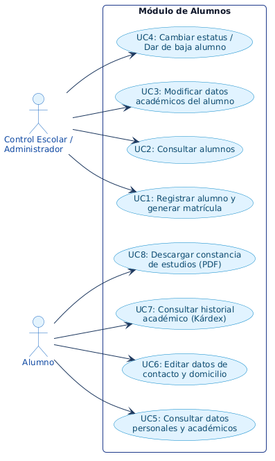

### Contrato de Precondiciones y Postcondiciones

| Caso de Uso | Precondición | Postcondición |
| :--- | :--- | :--- |
| **UC1: Registrar alumno y generar matrícula** | Control Escolar inició sesión y cuenta con permisos administrativos. | El alumno queda registrado con matrícula única y estatus `Activo`. |
| **UC2: Consultar alumnos** | Control Escolar inició sesión en el sistema. | Se muestra el listado o detalle del expediente sin modificar información. |
| **UC3: Modificar datos académicos** | El alumno existe en el padrón y Control Escolar inició sesión. | Se actualizan carrera, plan de estudios o semestre en el expediente. |
| **UC4: Cambiar estatus / Dar de baja** | El alumno existe en el padrón y Control Escolar inició sesión. | Se actualiza el estatus y se registra el movimiento en bitácora sin borrar historial. |
| **UC5: Consultar datos personales** | El alumno inició sesión en el sistema. | Se despliegan los datos institucionales (solo lectura) y de contacto. |
| **UC6: Editar datos de contacto** | El alumno inició sesión y captura datos con formato válido. | Se actualizan teléfono, correo alterno y domicilio en la base de datos. |
| **UC7: Consultar historial académico** | El alumno inició sesión y cuenta con actas oficializadas. | Se presenta el Kárdex ordenado por periodo con promedio y créditos acumulados. |
| **UC8: Descargar constancia de estudios** | El alumno inició sesión, tiene estatus `Activo` e inscripción vigente. | Se genera el documento PDF con folio único y se descarga al equipo del alumno. |

---

## Diagrama de Componentes

Muestra la arquitectura interna de piezas de software (interfaz web, controladores, generadores y base de datos) y las interfaces consumidas de módulos externos para cada caso de uso.

### UC1: Registrar alumno y generar matrícula
- **Código fuente UML:** [n1-m1-alumnos-dco-cu01.wsd](../architecture/diagrams/nivel-1-modulos/n1-m1-alumnos-dco-cu01.wsd)

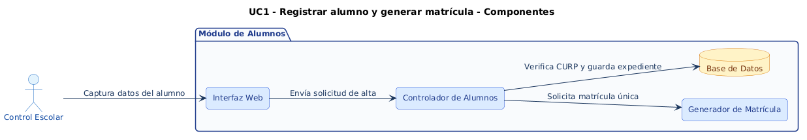

### UC2: Consultar alumnos
- **Código fuente UML:** [n1-m1-alumnos-dco-cu02.wsd](../architecture/diagrams/nivel-1-modulos/n1-m1-alumnos-dco-cu02.wsd)

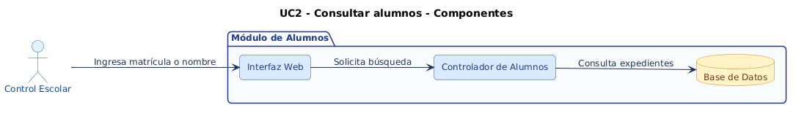

### UC3: Modificar datos académicos del alumno
- **Código fuente UML:** [n1-m1-alumnos-dco-cu03.wsd](../architecture/diagrams/nivel-1-modulos/n1-m1-alumnos-dco-cu03.wsd)

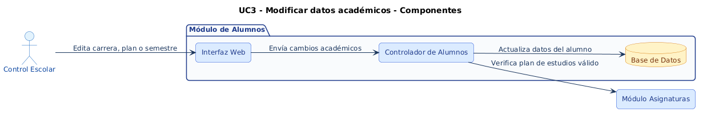

### UC4: Cambiar estatus / Dar de baja alumno
- **Código fuente UML:** [n1-m1-alumnos-dco-cu04.wsd](../architecture/diagrams/nivel-1-modulos/n1-m1-alumnos-dco-cu04.wsd)

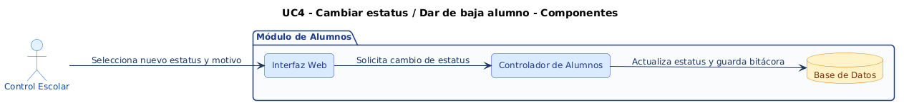

### UC5: Consultar datos personales y académicos
- **Código fuente UML:** [n1-m1-alumnos-dco-cu05.wsd](../architecture/diagrams/nivel-1-modulos/n1-m1-alumnos-dco-cu05.wsd)

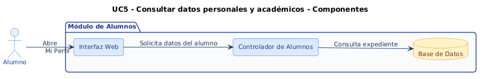

### UC6: Editar datos de contacto y domicilio
- **Código fuente UML:** [n1-m1-alumnos-dco-cu06.wsd](../architecture/diagrams/nivel-1-modulos/n1-m1-alumnos-dco-cu06.wsd)

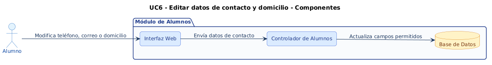

### UC7: Consultar historial académico (Kárdex)
- **Código fuente UML:** [n1-m1-alumnos-dco-cu07.wsd](../architecture/diagrams/nivel-1-modulos/n1-m1-alumnos-dco-cu07.wsd)

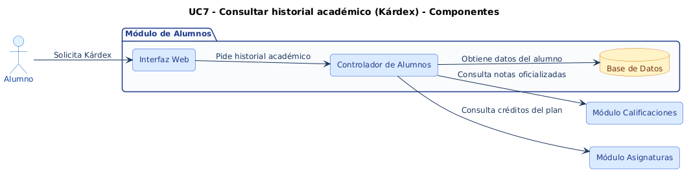

### UC8: Descargar constancia de estudios (PDF)
- **Código fuente UML:** [n1-m1-alumnos-dco-cu08.wsd](../architecture/diagrams/nivel-1-modulos/n1-m1-alumnos-dco-cu08.wsd)

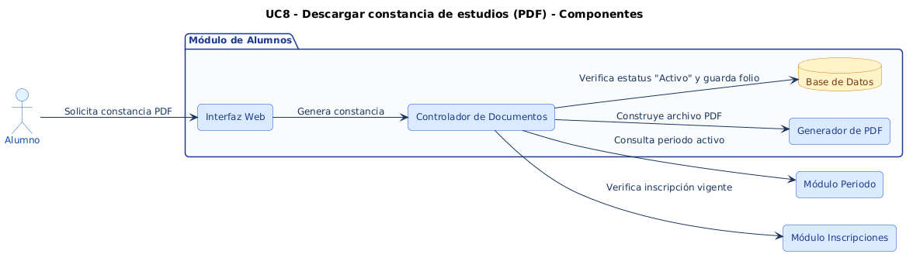

---

## Diagrama de Secuencia

Describe la interacción cronológica entre actores, fronteras de interfaz, controladores, módulos colaboradores y persistencia en base de datos, incluyendo flujos alternativos (`alt`) ante validaciones.

### UC1: Registrar alumno y generar matrícula
- **Código fuente UML:** [n1-m1-alumnos-dse-cu01.wsd](../architecture/diagrams/nivel-1-modulos/n1-m1-alumnos-dse-cu01.wsd)

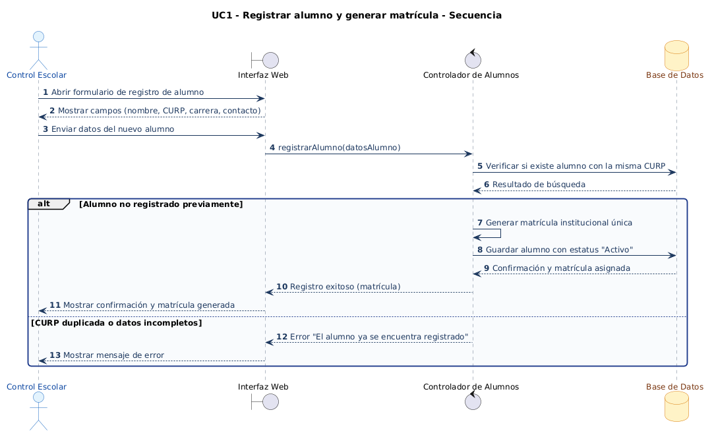

### UC2: Consultar alumnos
- **Código fuente UML:** [n1-m1-alumnos-dse-cu02.wsd](../architecture/diagrams/nivel-1-modulos/n1-m1-alumnos-dse-cu02.wsd)

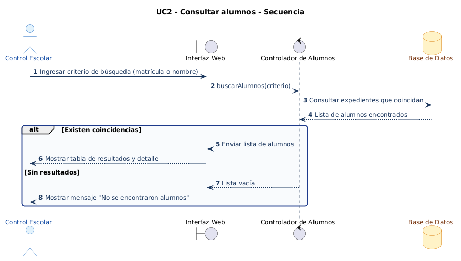

### UC3: Modificar datos académicos del alumno
- **Código fuente UML:** [n1-m1-alumnos-dse-cu03.wsd](../architecture/diagrams/nivel-1-modulos/n1-m1-alumnos-dse-cu03.wsd)

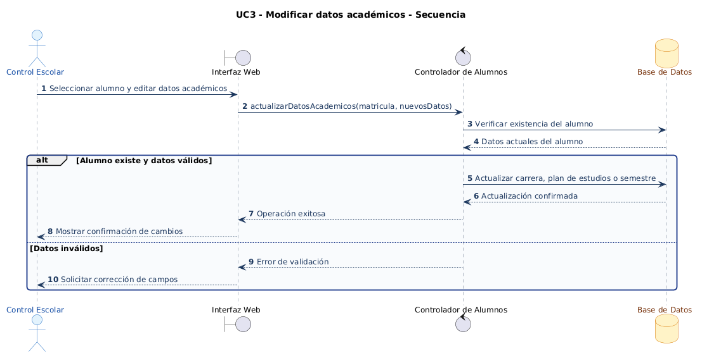

### UC4: Cambiar estatus / Dar de baja alumno
- **Código fuente UML:** [n1-m1-alumnos-dse-cu04.wsd](../architecture/diagrams/nivel-1-modulos/n1-m1-alumnos-dse-cu04.wsd)

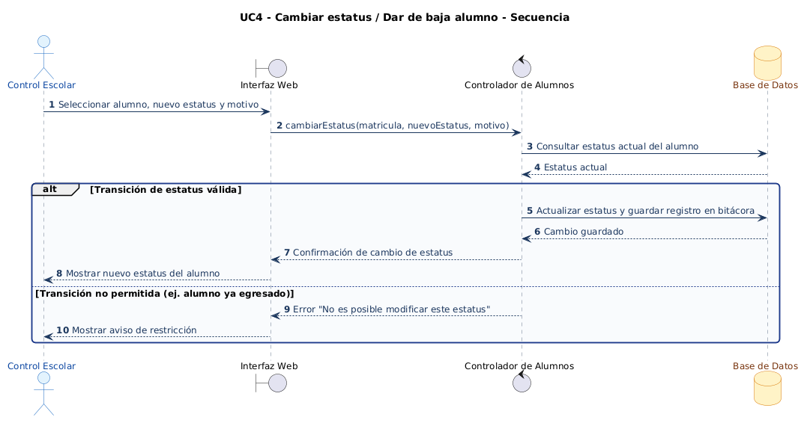

### UC5: Consultar datos personales y académicos
- **Código fuente UML:** [n1-m1-alumnos-dse-cu05.wsd](../architecture/diagrams/nivel-1-modulos/n1-m1-alumnos-dse-cu05.wsd)

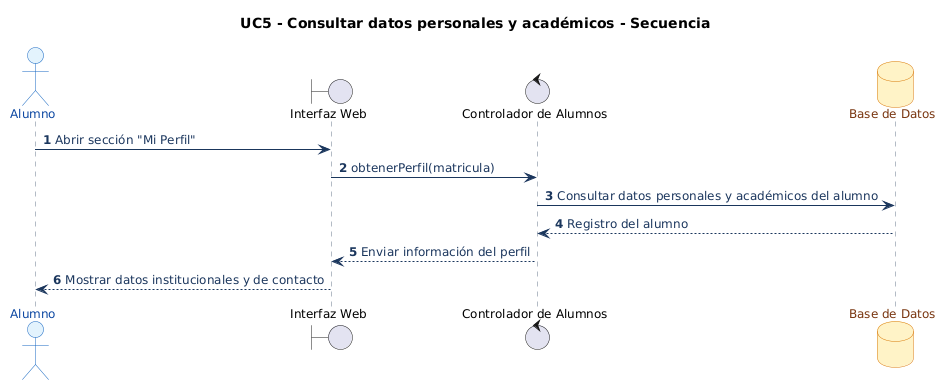

### UC6: Editar datos de contacto y domicilio
- **Código fuente UML:** [n1-m1-alumnos-dse-cu06.wsd](../architecture/diagrams/nivel-1-modulos/n1-m1-alumnos-dse-cu06.wsd)

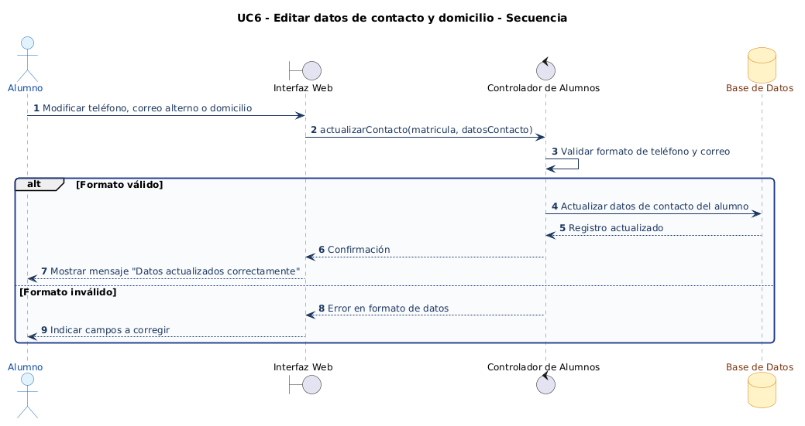

### UC7: Consultar historial académico (Kárdex)
- **Código fuente UML:** [n1-m1-alumnos-dse-cu07.wsd](../architecture/diagrams/nivel-1-modulos/n1-m1-alumnos-dse-cu07.wsd)

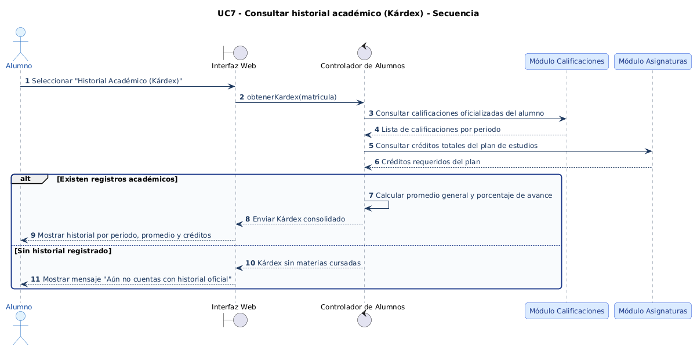

### UC8: Descargar constancia de estudios (PDF)
- **Código fuente UML:** [n1-m1-alumnos-dse-cu08.wsd](../architecture/diagrams/nivel-1-modulos/n1-m1-alumnos-dse-cu08.wsd)

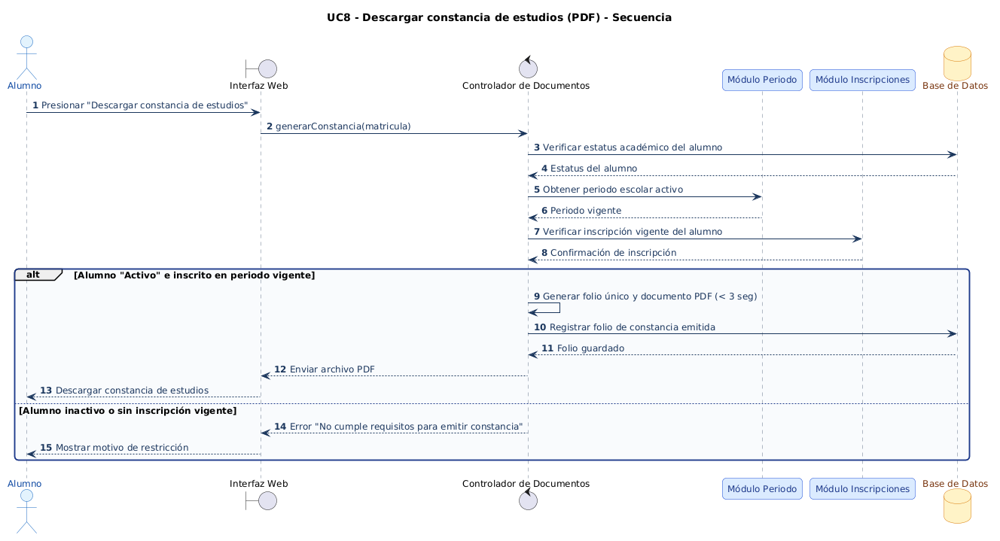

---

## Diagrama de Actividades

Modela el flujo operativo paso a paso mediante carriles (*swimlanes*) que separan las acciones del usuario de las validaciones automáticas del sistema.

### UC1: Registrar alumno y generar matrícula
- **Código fuente UML:** [n1-m1-alumnos-dac-cu01.wsd](../architecture/diagrams/nivel-1-modulos/n1-m1-alumnos-dac-cu01.wsd)

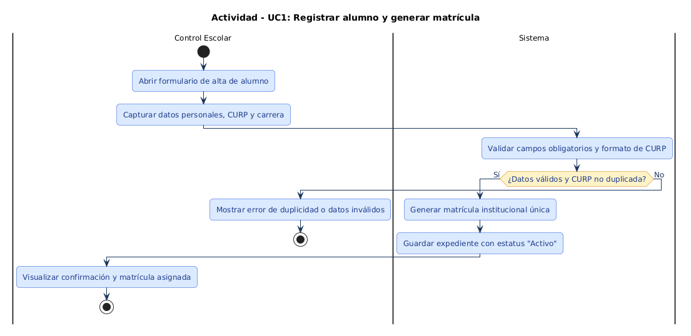

### UC2: Consultar alumnos
- **Código fuente UML:** [n1-m1-alumnos-dac-cu02.wsd](../architecture/diagrams/nivel-1-modulos/n1-m1-alumnos-dac-cu02.wsd)

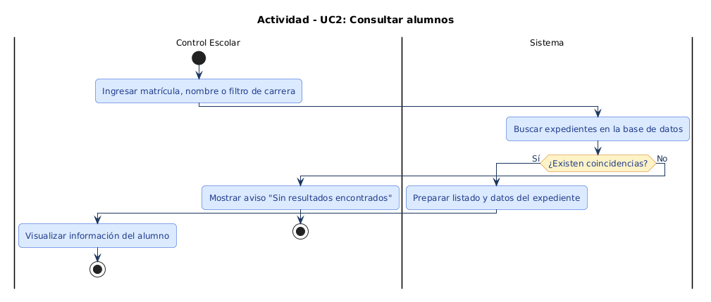

### UC3: Modificar datos académicos del alumno
- **Código fuente UML:** [n1-m1-alumnos-dac-cu03.wsd](../architecture/diagrams/nivel-1-modulos/n1-m1-alumnos-dac-cu03.wsd)

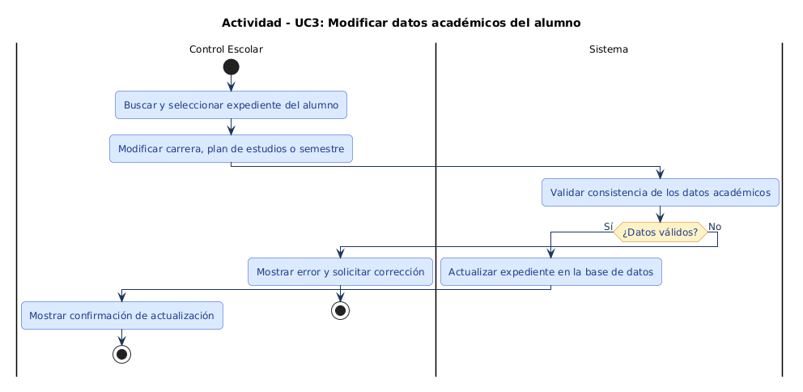

### UC4: Cambiar estatus / Dar de baja alumno
- **Código fuente UML:** [n1-m1-alumnos-dac-cu04.wsd](../architecture/diagrams/nivel-1-modulos/n1-m1-alumnos-dac-cu04.wsd)

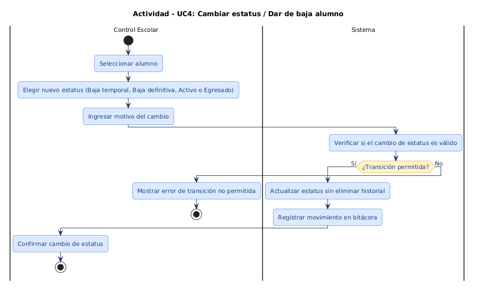

### UC5: Consultar datos personales y académicos
- **Código fuente UML:** [n1-m1-alumnos-dac-cu05.wsd](../architecture/diagrams/nivel-1-modulos/n1-m1-alumnos-dac-cu05.wsd)

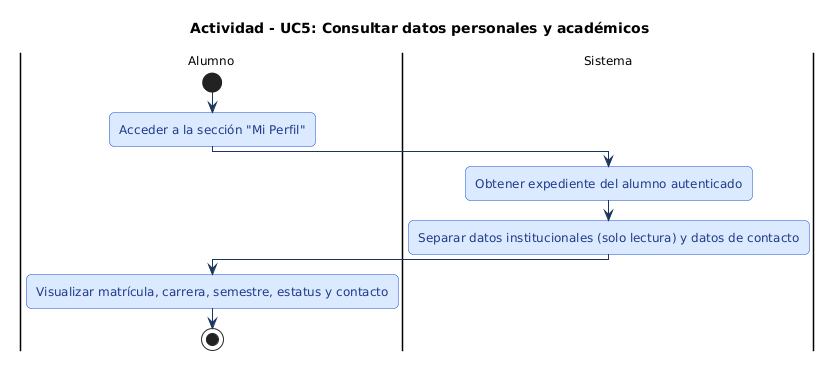

### UC6: Editar datos de contacto y domicilio
- **Código fuente UML:** [n1-m1-alumnos-dac-cu06.wsd](../architecture/diagrams/nivel-1-modulos/n1-m1-alumnos-dac-cu06.wsd)

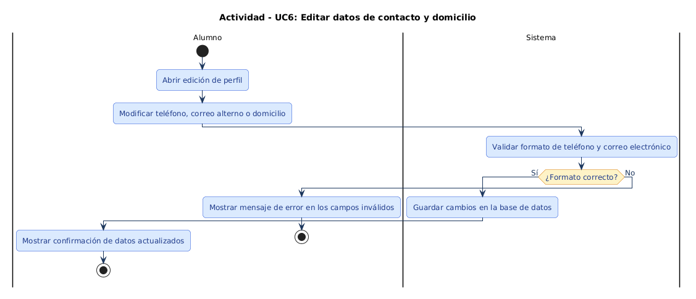

### UC7: Consultar historial académico (Kárdex)
- **Código fuente UML:** [n1-m1-alumnos-dac-cu07.wsd](../architecture/diagrams/nivel-1-modulos/n1-m1-alumnos-dac-cu07.wsd)

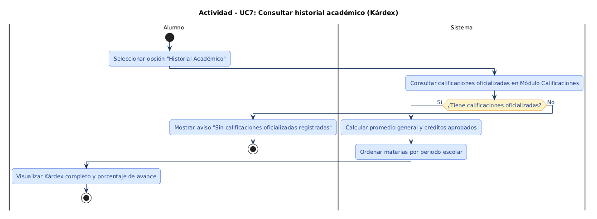

### UC8: Descargar constancia de estudios (PDF)
- **Código fuente UML:** [n1-m1-alumnos-dac-cu08.wsd](../architecture/diagrams/nivel-1-modulos/n1-m1-alumnos-dac-cu08.wsd)

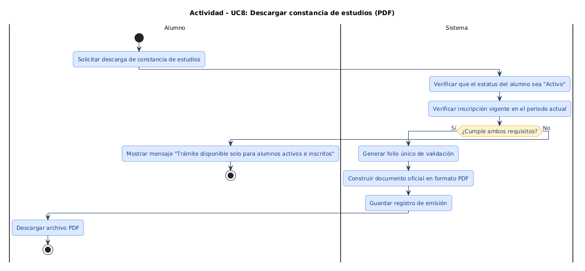

---

## Diagrama de Estados

### 1. Ciclo de vida del Alumno (Estatus Académico)

Representa las transiciones administrativas permitidas sobre el expediente estudiantil (`Activo`, `Baja Temporal`, `Baja Definitiva` y `Egresado`).

- **Código fuente UML:** [n1-m1-alumnos-des-alumno.wsd](../architecture/diagrams/nivel-1-modulos/n1-m1-alumnos-des-alumno.wsd)

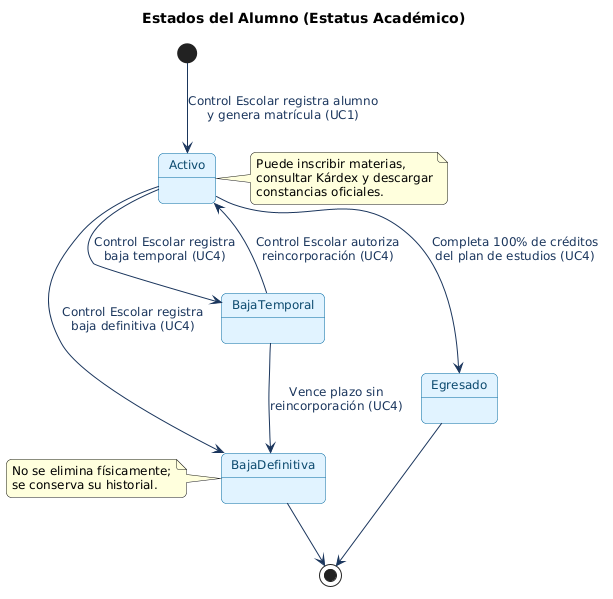

### 2. Ciclo de vida de la Constancia de Estudios

Representa los estados por los que atraviesa una solicitud de constancia oficial desde su petición hasta su descarga en formato PDF (`Solicitada` $\rightarrow$ `Validando` $\rightarrow$ `Generada` / `Rechazada` $\rightarrow$ `Descargada`).

- **Código fuente UML:** [n1-m1-alumnos-des-constancia.wsd](../architecture/diagrams/nivel-1-modulos/n1-m1-alumnos-des-constancia.wsd)

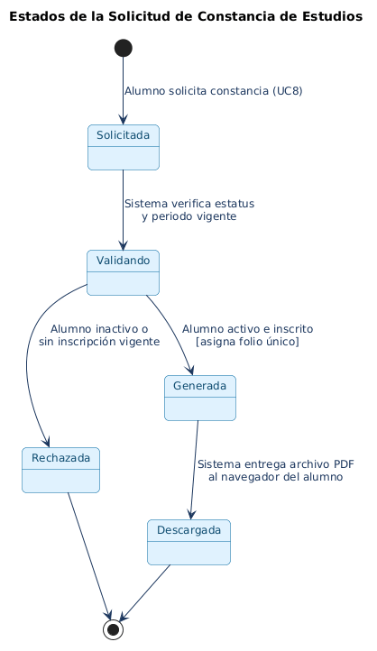

---

## Diagrama de Clases

> [!IMPORTANT]
> El diagrama de clases completo del sistema se integra de manera unica a nivel proyecto; a continuación se detallan las entidades propias del **Módulo de Alumnos** (`Alumno`, `EstatusAlumno`, `ConstanciaEstudios`, `BitacoraEstatus`) y sus asociaciones con las entidades externas de otros módulos.

- **Código fuente UML:** [n1-m1-alumnos-dcl.wsd](../architecture/diagrams/nivel-1-modulos/n1-m1-alumnos-dcl.wsd)

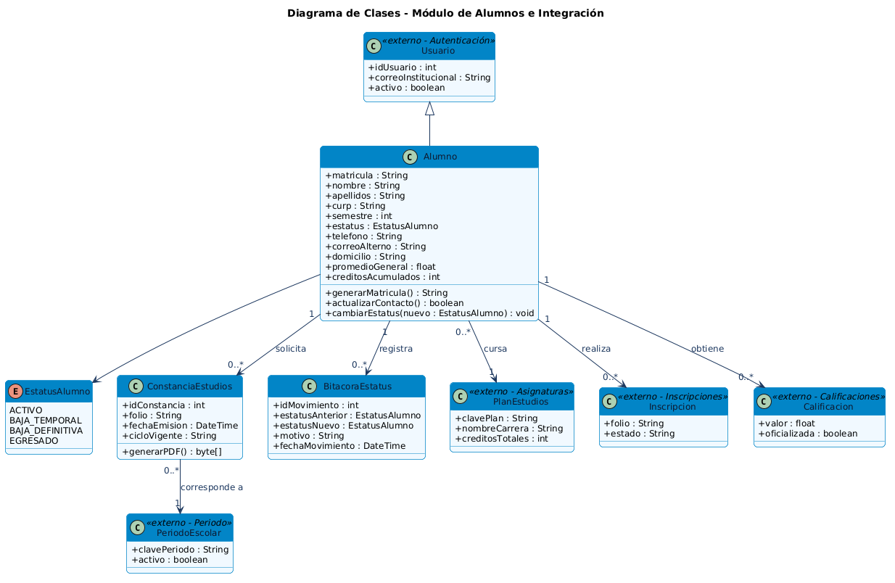

---

## Integración con Otros Módulos

| Módulo Relacionado | Tipo de Interacción | Datos Intercambiados |
| :--- | :--- | :--- |
| **Inicio de Sesión** | Precondición / Herencia | Identidad autenticada (`Usuario`) y rol (`Alumno` o `Control Escolar`). |
| **Módulo 2: Periodo** | Consulta | Identificador y fechas del `PeriodoEscolar` activo para validar constancias (`UC8`). |
| **Módulo 2: Inscripciones** | Bidireccional | Entrega estatus `Activo` del alumno; consulta inscripción vigente para emitir constancia (`UC8`). |
| **Módulo 4: Asignaturas** | Consulta | Créditos totales del `PlanEstudios` para calcular porcentaje de avance en el Kárdex (`UC7`). |
| **Módulo 8: Calificaciones** | Consulta | Actas oficializadas por periodo para construir el Kárdex y promedio general (`UC7`). |

---

## Glosario y Abreviaturas

- **Matrícula:** Identificador institucional único asignado automáticamente al alumno al momento de su registro.
- **Kárdex (Historial académico):** Vista consolidada de todas las asignaturas cursadas por el estudiante, con sus calificaciones oficializadas, créditos aprobados y promedio general.
- **Constancia de estudios:** Documento oficial en formato PDF con folio único que acredita que el estudiante se encuentra activo e inscrito en el ciclo vigente.
- **Baja lógica:** Cambio de estatus administrativo a inactivo (`Baja Temporal` o `Baja Definitiva`) sin eliminar registros físicos de la base de datos.
- **RF / RNF:** Requerimiento Funcional / Requerimiento No Funcional.
- **UC:** Caso de Uso (*Use Case*).

---

## Requerimientos No Funcionales

- **RNF-01 (Control de acceso por rol):** Solo Control Escolar puede dar de alta alumnos, editar datos académicos o cambiar estatus; el alumno solo consulta su propio expediente y edita sus datos de contacto.
- **RNF-02 (Unicidad e integridad):** El sistema debe impedir el registro de matrículas o CURP duplicadas en el padrón estudiantil.
- **RNF-03 (Conservación histórica / Baja lógica):** Ningún expediente estudiantil se elimina físicamente; toda baja queda asentada en `BitacoraEstatus`.
- **RNF-04 (Tiempo de respuesta en consultas):** La búsqueda de expedientes y la carga del Kárdex deben responder en menos de 3 segundos en condiciones normales.
- **RNF-05 (Generación rápida de PDF):** La emisión y descarga de constancias oficiales en PDF no debe exceder los 3 segundos.
- **RNF-06 (Disponibilidad):** El módulo debe garantizar una disponibilidad mínima del 99% durante periodos de inscripción y trámites escolares.
- **RNF-07 (Diseño responsivo):** La interfaz web debe adaptarse correctamente a computadoras de escritorio, tabletas y teléfonos móviles.
- **RNF-08 (Usabilidad y accesibilidad):** La interfaz debe diferenciar visualmente los campos institucionales de solo lectura frente a los campos editables por el alumno.