# Módulo Alumnos

> Equipo 1: Alumnos

# Resumen

El **Módulo de Alumnos** constituye el catálogo maestro estudiantil del Sistema de Control Escolar. Su propósito es administrar el expediente institucional de cada estudiante desde su ingreso hasta su egreso, así como ofrecer un portal de autogestión para el alumno.

Por un lado, permite al personal de **Control Escolar** registrar alumnos de nuevo ingreso, generar su matrícula única, actualizar su situación académica y gestionar cambios de estatus o bajas sin eliminar su historial. Por otro lado, permite al **Alumno** consultar sus datos personales y académicos, actualizar su información de contacto y domicilio, revisar su historial académico consolidado (Kárdex) y descargar constancias oficiales de estudios en formato PDF.

# Objetivo y Alcance

## Objetivo general

Centralizar y mantener íntegro el padrón estudiantil y los expedientes académicos de la institución, proporcionando al personal administrativo herramientas de control escolar y a los alumnos un acceso claro para consultar su trayectoria y emitir documentos oficiales.

## Objetivos específicos

- Permitir al personal de Control Escolar dar de alta alumnos de nuevo ingreso y generar su matrícula institucional de forma única.
- Facilitar la consulta y actualización de los datos académicos y del estatus escolar de los estudiantes (activo, baja temporal, baja definitiva o egresado).
- Permitir al alumno consultar su perfil institucional y mantener actualizados sus datos personales de contacto y domicilio.
- Integrar el historial académico (Kárdex) con las calificaciones oficializadas para calcular promedio general y créditos acumulados.
- Generar y permitir la descarga de constancias oficiales de estudios en formato PDF para alumnos activos.

## Alcance

**Dentro del alcance:**

- Registro de alumnos de nuevo ingreso y generación de matrícula única.
- Consulta de expedientes estudiantiles y modificación de datos académicos por Control Escolar.
- Gestión de estatus académico y baja lógica de alumnos (conservando su historial).
- Consulta de datos personales/académicos y edición de datos de contacto y domicilio por el alumno.
- Consulta del historial académico (Kárdex) consolidado.
- Generación y descarga de constancia de estudios en PDF.

**Fuera del alcance:**

- Inicio de sesión, cierre de sesión por inactividad y cambio de contraseña (correspondiente al Módulo de Inicio de Sesión).
- Selección de materias, trámites de inscripción/reinscripción, consulta de horarios vigentes y comprobantes de carga académica (correspondiente al Módulo 2: Inscripciones).
- Definición del mapa curricular y seriación de materias (correspondiente al Módulo 4: Asignaturas/Materias).
- Captura de asistencias y calificaciones por grupo (correspondiente al Módulo de Registro de Calificaciones).

# Requerimientos funcionales

- **RF-01 (Registrar alumno y generar matrícula):** El sistema permitirá a Control Escolar registrar un alumno de nuevo ingreso con sus datos personales y académicos, asignándole una matrícula institucional única.
- **RF-02 (Consultar alumnos):** El sistema permitirá a Control Escolar buscar y consultar el listado y detalle de los alumnos registrados mediante matrícula, nombre o carrera.
- **RF-03 (Modificar datos académicos):** El sistema permitirá a Control Escolar actualizar los datos académicos institucionales del alumno (carrera, plan de estudios o semestre).
- **RF-04 (Cambiar estatus / Dar de baja alumno):** El sistema permitirá a Control Escolar cambiar el estatus del alumno (Activo, Baja temporal, Baja definitiva o Egresado) conservando su historial académico sin eliminarlo físicamente.
- **RF-05 (Consultar datos personales y académicos):** El alumno podrá visualizar su información institucional (matrícula, nombre, CURP, carrera, semestre y estatus) y sus datos de contacto.
- **RF-06 (Editar datos de contacto y domicilio):** El alumno podrá actualizar únicamente su teléfono, correo electrónico alterno y domicilio, manteniendo bloqueados sus datos institucionales.
- **RF-07 (Consultar historial académico):** El alumno podrá consultar su Kárdex completo con todas las materias cursadas, calificaciones oficializadas, créditos acumulados y promedio general.
- **RF-08 (Descargar constancia de estudios):** El sistema generará y permitirá descargar una constancia oficial de estudios en PDF con folio único, validando previamente que el alumno tenga estatus activo.

## Relación entre requerimientos y casos de uso

| Requerimiento | Caso de uso que lo cumple | Actor principal |
|---|---|---|
| RF-01 | UC1: Registrar alumno y generar matrícula | Control Escolar / Administrador |
| RF-02 | UC2: Consultar alumnos | Control Escolar / Administrador |
| RF-03 | UC3: Modificar datos académicos del alumno | Control Escolar / Administrador |
| RF-04 | UC4: Cambiar estatus / Dar de baja alumno | Control Escolar / Administrador |
| RF-05 | UC5: Consultar datos personales y académicos | Alumno |
| RF-06 | UC6: Editar datos de contacto y domicilio | Alumno |
| RF-07 | UC7: Consultar historial académico (Kárdex) | Alumno |
| RF-08 | UC8: Descargar constancia de estudios (PDF) | Alumno |

# Actores

Un **actor** representa el rol externo que interactúa con el módulo para realizar una tarea con valor dentro del sistema. En este módulo participan dos roles diferenciados:

| Actor | ¿Qué representa? | Funciones dentro del módulo |
|---|---|---|
| **Control Escolar / Administrador** | Personal administrativo autorizado de la institución responsable del padrón estudiantil y de la validez de los registros oficiales de los alumnos. | Registrar alumnos de nuevo ingreso y generar matrículas, consultar expedientes, modificar datos académicos y gestionar cambios de estatus o bajas. |
| **Alumno** | Estudiante registrado en la institución con matrícula asignada y cuenta activa en el sistema. | Consultar sus datos personales y académicos, actualizar su información de contacto y domicilio, revisar su historial académico (Kárdex) y descargar constancias de estudios en PDF. |

# Diagrama de casos de uso

Un **diagrama de casos de uso** describe visualmente las funcionalidades que ofrece el módulo (óvalos) y qué actores interactúan con cada una. Se divide en dos bloques funcionales: la administración del expediente por parte de **Control Escolar** (`UC1`–`UC4`) y la autogestión y consulta del **Alumno** (`UC5`–`UC8`).

**Código fuente UML:** [m1_alumnos_casos_de_uso.puml](resources/uml/m1_alumnos/m1_alumnos_casos_de_uso.puml)

**Imagen del diagrama:**

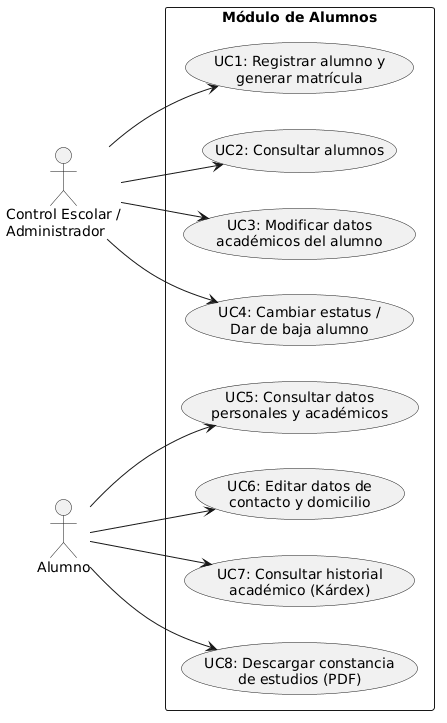

## Precondiciones y postcondiciones

| Caso de uso | Precondición | Postcondición |
|---|---|---|
| **UC1: Registrar alumno y generar matrícula** | El usuario de Control Escolar inició sesión y cuenta con permisos administrativos. | El alumno queda registrado con matrícula única y estatus `Activo`. |
| **UC2: Consultar alumnos** | El usuario de Control Escolar inició sesión. | Se muestra el listado o expediente del alumno consultado sin alterar datos. |
| **UC3: Modificar datos académicos** | El alumno existe en el padrón y Control Escolar inició sesión. | Se actualizan los datos académicos (carrera, plan o semestre) en el expediente. |
| **UC4: Cambiar estatus / Dar de baja** | El alumno existe en el padrón y Control Escolar inició sesión. | El estatus del alumno cambia (ej. `Baja temporal` o `Baja definitiva`) conservando su historial. |
| **UC5: Consultar datos personales** | El alumno inició sesión en el sistema. | Se muestran los datos institucionales (solo lectura) y datos de contacto del alumno. |
| **UC6: Editar datos de contacto** | El alumno inició sesión y los datos capturados tienen formato válido. | Se actualizan teléfono, correo alterno y domicilio en la base de datos. |
| **UC7: Consultar historial académico** | El alumno inició sesión y existen calificaciones oficializadas en el sistema. | Se despliega el Kárdex completo con promedio general y créditos acumulados. |
| **UC8: Descargar constancia de estudios** | El alumno inició sesión y cuenta con estatus `Activo` e inscripción vigente. | Se genera el documento PDF con folio único y se descarga al dispositivo del alumno. |

# Diagrama de componentes

Un **diagrama de componentes** muestra las piezas de software que participan en cada caso de uso (interfaz, controlador, base de datos y módulos externos relacionados). Se incluye un diagrama por cada caso de uso.

## UC1: Registrar alumno y generar matrícula

**Código fuente UML:** [m1_uc1_componentes.puml](resources/uml/m1_alumnos/m1_uc1_componentes.puml)

**Imagen del diagrama:**

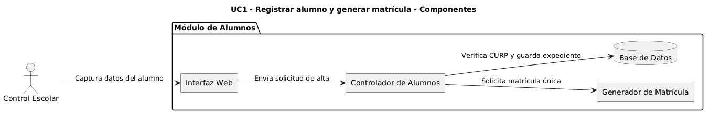

---

## UC2: Consultar alumnos

**Código fuente UML:** [m1_uc2_componentes.puml](resources/uml/m1_alumnos/m1_uc2_componentes.puml)

**Imagen del diagrama:**

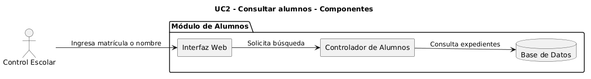

---

## UC3: Modificar datos académicos del alumno

**Código fuente UML:** [m1_uc3_componentes.puml](resources/uml/m1_alumnos/m1_uc3_componentes.puml)

**Imagen del diagrama:**

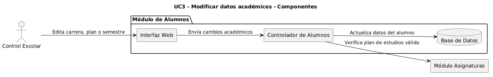

---

## UC4: Cambiar estatus / Dar de baja alumno

**Código fuente UML:** [m1_uc4_componentes.puml](resources/uml/m1_alumnos/m1_uc4_componentes.puml)

**Imagen del diagrama:**

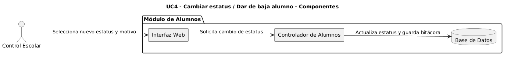

---

## UC5: Consultar datos personales y académicos

**Código fuente UML:** [m1_uc5_componentes.puml](resources/uml/m1_alumnos/m1_uc5_componentes.puml)

**Imagen del diagrama:**

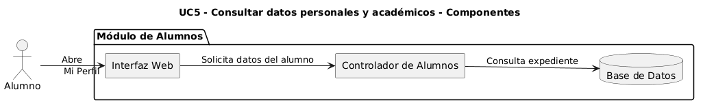

---

## UC6: Editar datos de contacto y domicilio

**Código fuente UML:** [m1_uc6_componentes.puml](resources/uml/m1_alumnos/m1_uc6_componentes.puml)

**Imagen del diagrama:**

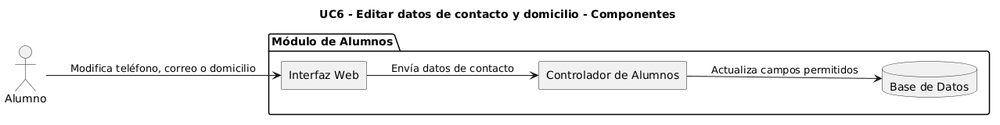

---

## UC7: Consultar historial académico (Kárdex)

**Código fuente UML:** [m1_uc7_componentes.puml](resources/uml/m1_alumnos/m1_uc7_componentes.puml)

**Imagen del diagrama:**

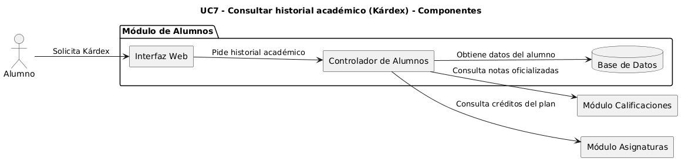

---

## UC8: Descargar constancia de estudios (PDF)

**Código fuente UML:** [m1_uc8_componentes.puml](resources/uml/m1_alumnos/m1_uc8_componentes.puml)

**Imagen del diagrama:**

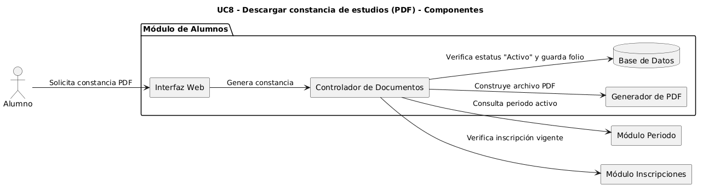

---

# Diagrama de secuencia

Un **diagrama de secuencia** muestra en orden cronológico los mensajes que intercambian el actor, la interfaz de usuario, la lógica de control del módulo, los módulos externos relacionados y la base de datos durante la ejecución de un caso de uso. Los bloques `alt` representan las decisiones ante validaciones exitosas o errores.

## UC1: Registrar alumno y generar matrícula

**Descripción:** Control Escolar captura los datos personales y académicos de un aspirante aceptado. El sistema verifica que la CURP no esté duplicada, genera automáticamente una matrícula institucional única y guarda el expediente con estatus `Activo`.

**Código fuente UML:** [m1_uc1_secuencia.puml](resources/uml/m1_alumnos/m1_uc1_secuencia.puml)

**Imagen del diagrama:**

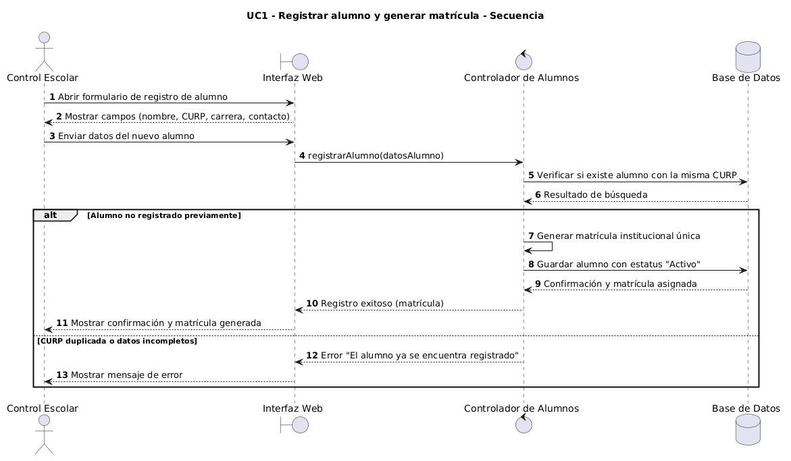

---

## UC2: Consultar alumnos

**Descripción:** Control Escolar busca estudiantes por matrícula, nombre o carrera para revisar su información general y situación académica actual.

**Código fuente UML:** [m1_uc2_secuencia.puml](resources/uml/m1_alumnos/m1_uc2_secuencia.puml)

**Imagen del diagrama:**

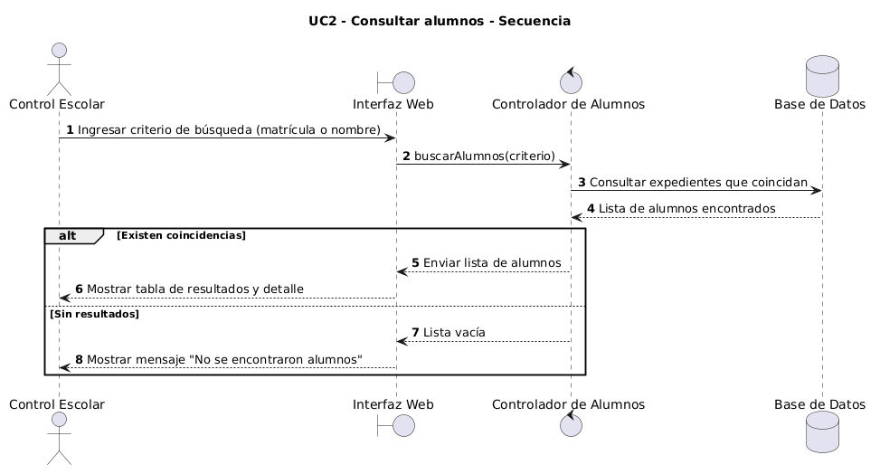

---

## UC3: Modificar datos académicos del alumno

**Descripción:** Control Escolar selecciona un expediente existente para actualizar información institucional que el estudiante no puede editar por sí mismo, como cambio de carrera, plan de estudios o semestre.

**Código fuente UML:** [m1_uc3_secuencia.puml](resources/uml/m1_alumnos/m1_uc3_secuencia.puml)

**Imagen del diagrama:**

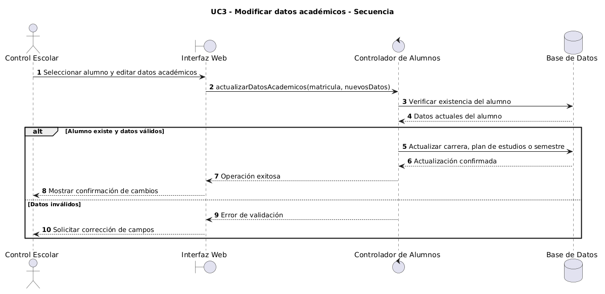

---

## UC4: Cambiar estatus / Dar de baja alumno

**Descripción:** Control Escolar modifica el estatus del estudiante (`Activo`, `Baja temporal`, `Baja definitiva` o `Egresado`) registrando el motivo. Nunca se borra el registro físico para preservar la integridad histórica.

**Código fuente UML:** [m1_uc4_secuencia.puml](resources/uml/m1_alumnos/m1_uc4_secuencia.puml)

**Imagen del diagrama:**

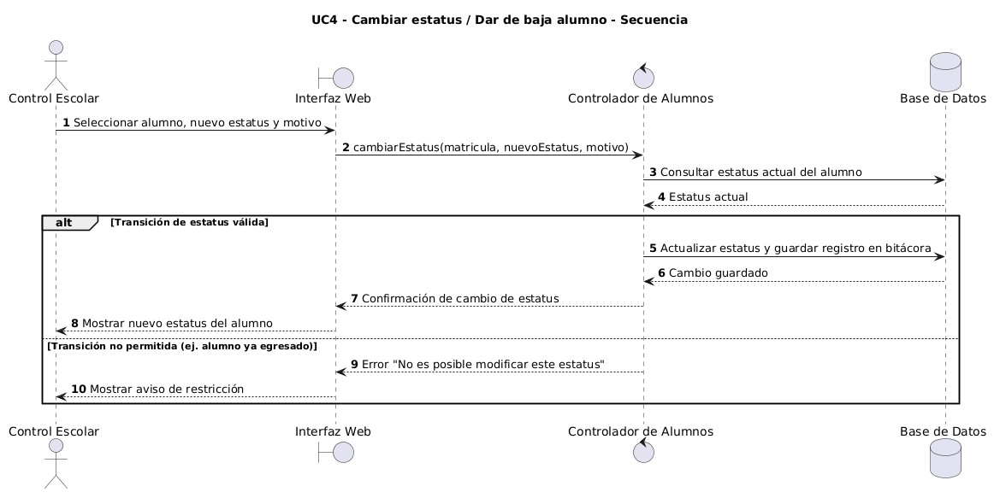

---

## UC5: Consultar datos personales y académicos

**Descripción:** El alumno autenticado accede a su perfil para visualizar su matrícula, carrera, semestre, estatus escolar y datos de contacto registrados.

**Código fuente UML:** [m1_uc5_secuencia.puml](resources/uml/m1_alumnos/m1_uc5_secuencia.puml)

**Imagen del diagrama:**

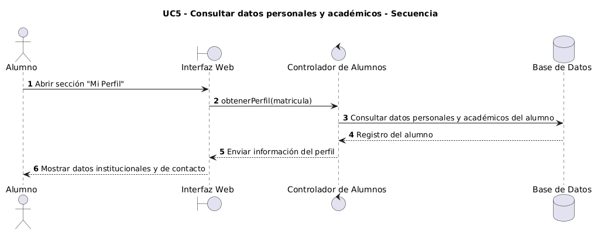

---

## UC6: Editar datos de contacto y domicilio

**Descripción:** El alumno actualiza su teléfono, correo electrónico personal o domicilio. El controlador valida el formato de los datos y restringe la edición exclusivamente a campos de contacto.

**Código fuente UML:** [m1_uc6_secuencia.puml](resources/uml/m1_alumnos/m1_uc6_secuencia.puml)

**Imagen del diagrama:**

---

## UC7: Consultar historial académico (Kárdex)

**Descripción:** El alumno consulta su trayectoria académica completa. El controlador solicita al **Módulo de Registro de Calificaciones** las actas oficializadas del estudiante, calcula el promedio general y los créditos acumulados, y presenta el Kárdex.

**Código fuente UML:** [m1_uc7_secuencia.puml](resources/uml/m1_alumnos/m1_uc7_secuencia.puml)

**Imagen del diagrama:**

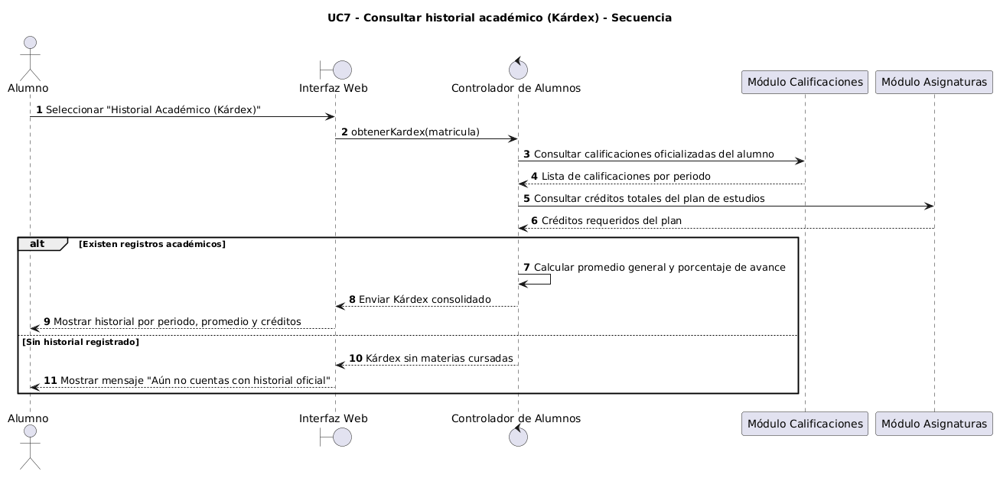

---

## UC8: Descargar constancia de estudios (PDF)

**Descripción:** El alumno solicita una constancia oficial de estudios. El controlador verifica que el alumno tenga estatus `Activo` y consulta al **Módulo de Periodo** e **Inscripciones** para confirmar que esté inscrito en el ciclo vigente antes de generar el PDF con folio único.

**Código fuente UML:** [m1_uc8_secuencia.puml](resources/uml/m1_alumnos/m1_uc8_secuencia.puml)

**Imagen del diagrama:**

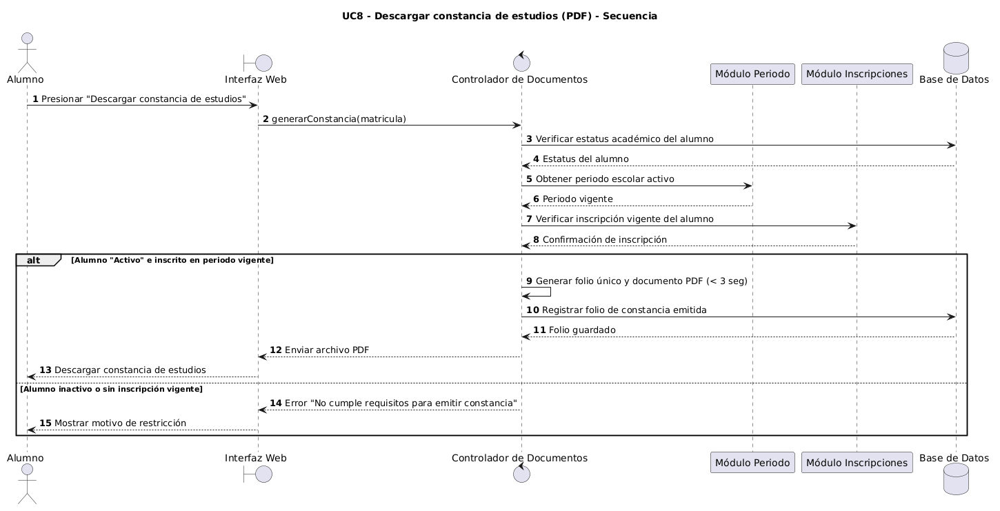

---

# Diagrama de actividades

Un **diagrama de actividades** representa el flujo paso a paso de cada proceso, dividiendo las acciones en carriles según quién las ejecuta (el usuario o el sistema) y mostrando los puntos de decisión (rombos) que determinan el resultado de la operación.

## UC1: Registrar alumno y generar matrícula

**Código fuente UML:** [m1_uc1_actividad.puml](resources/uml/m1_alumnos/m1_uc1_actividad.puml)

**Imagen del diagrama:**

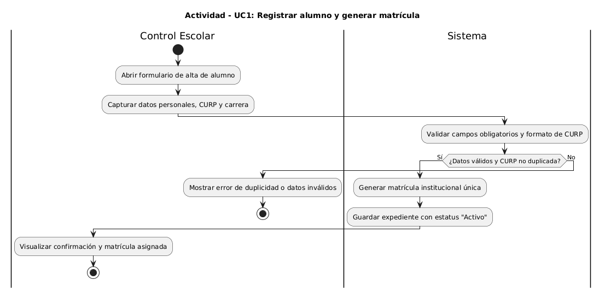

---

## UC2: Consultar alumnos

**Código fuente UML:** [m1_uc2_actividad.puml](resources/uml/m1_alumnos/m1_uc2_actividad.puml)

**Imagen del diagrama:**

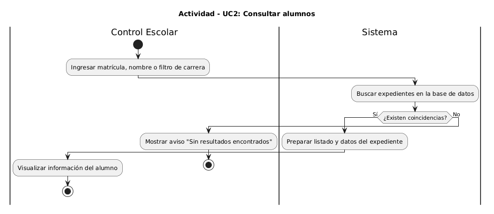

---

## UC3: Modificar datos académicos del alumno

**Código fuente UML:** [m1_uc3_actividad.puml](resources/uml/m1_alumnos/m1_uc3_actividad.puml)

**Imagen del diagrama:**

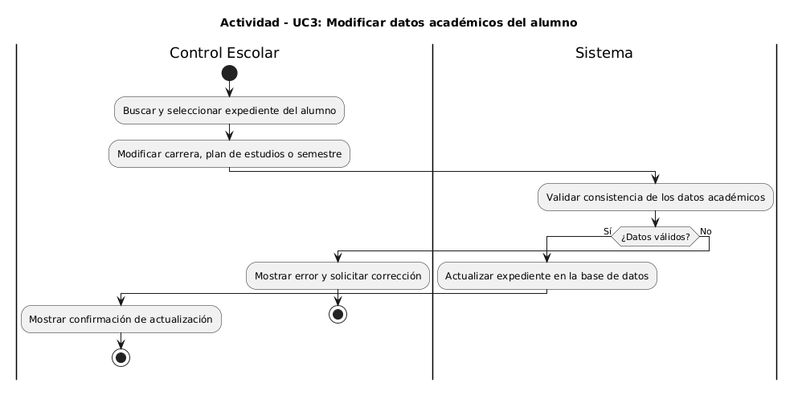

---

## UC4: Cambiar estatus / Dar de baja alumno

**Código fuente UML:** [m1_uc4_actividad.puml](resources/uml/m1_alumnos/m1_uc4_actividad.puml)

**Imagen del diagrama:**

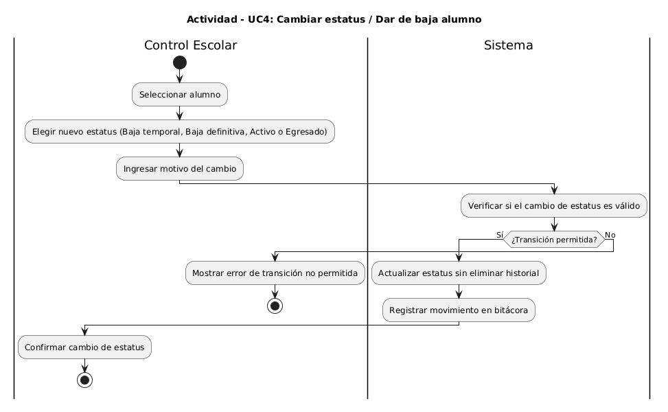

---

## UC5: Consultar datos personales y académicos

**Código fuente UML:** [m1_uc5_actividad.puml](resources/uml/m1_alumnos/m1_uc5_actividad.puml)

**Imagen del diagrama:**

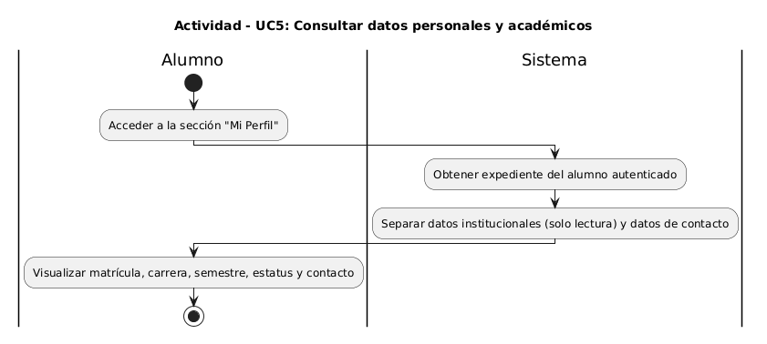

---

## UC6: Editar datos de contacto y domicilio

**Código fuente UML:** [m1_uc6_actividad.puml](resources/uml/m1_alumnos/m1_uc6_actividad.puml)

**Imagen del diagrama:**

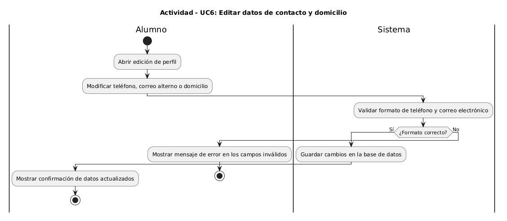

---

## UC7: Consultar historial académico (Kárdex)

**Código fuente UML:** [m1_uc7_actividad.puml](resources/uml/m1_alumnos/m1_uc7_actividad.puml)

**Imagen del diagrama:**

---

## UC8: Descargar constancia de estudios (PDF)

**Código fuente UML:** [m1_uc8_actividad.puml](resources/uml/m1_alumnos/m1_uc8_actividad.puml)

**Imagen del diagrama:**

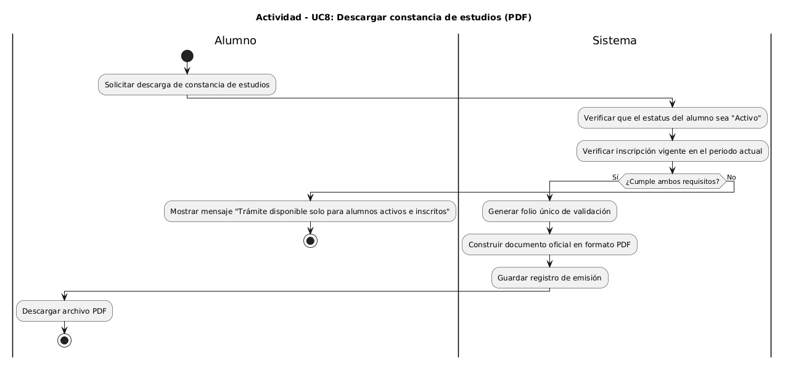

---

# Diagrama de estados

Un **diagrama de estados** muestra las distintas situaciones por las que pasa un objeto clave del módulo a lo largo de su ciclo de vida y los eventos que provocan cada transición.

## Diagrama 1: Ciclo de vida del Alumno (Estatus Académico)

**Descripción:** Representa los estados oficiales de un estudiante dentro del padrón escolar (`Activo`, `Baja Temporal`, `Baja Definitiva` y `Egresado`). Controla qué operaciones puede realizar el estudiante en el sistema (por ejemplo, inscribirse o solicitar constancias).

**Código fuente UML:** [m1_estados_alumno.puml](resources/uml/m1_alumnos/m1_estados_alumno.puml)

**Imagen del diagrama:**

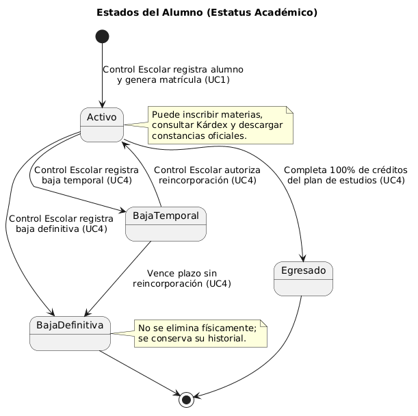

---

## Diagrama 2: Ciclo de vida de la Constancia de Estudios

**Descripción:** Representa el proceso de validación, generación y emisión de una constancia oficial en PDF solicitada por el alumno (`UC8`).

**Código fuente UML:** [m1_estados_constancia.puml](resources/uml/m1_alumnos/m1_estados_constancia.puml)

**Imagen del diagrama:**

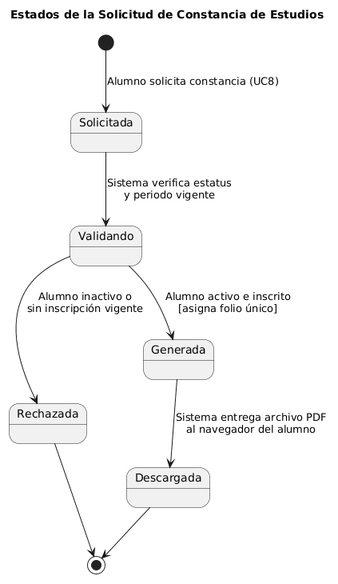

---

# Diagrama de clases

De acuerdo con los lineamientos del proyecto, el sistema cuenta con un **único diagrama de clases global** ubicado en el `README.md` principal para evitar duplicidad de entidades entre equipos. A continuación se muestra la estructura de clases correspondiente al **Módulo de Alumnos** y su relación directa con las entidades externas de los demás módulos (`Usuario`, `PlanEstudios`, `PeriodoEscolar`, `Inscripcion` y `Calificacion`).

**Código fuente UML:** [m1_alumnos_clases.puml](resources/uml/m1_alumnos/m1_alumnos_clases.puml)

**Imagen del diagrama:**

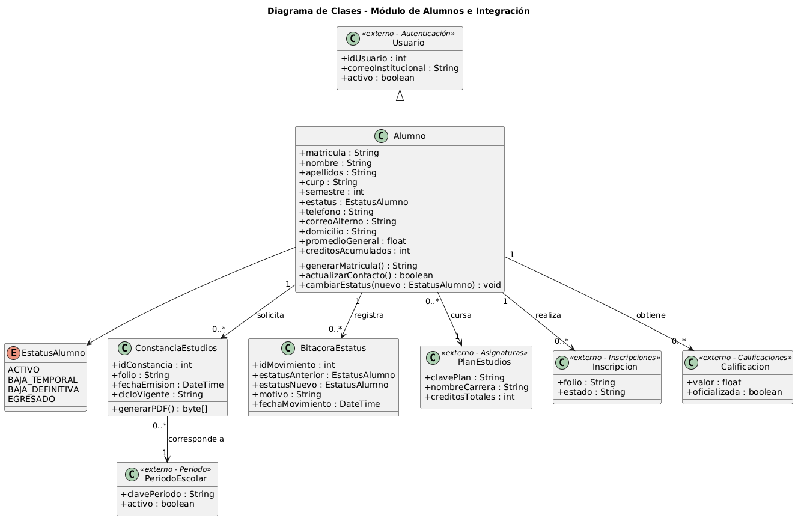

# Relación con otros módulos

- **Inicio de Sesión / Autenticación:** Valida la identidad y el rol (`Alumno` o `Control Escolar`) antes de permitir el acceso a las funciones de este módulo.
- **Módulo 2 (Periodo):** Provee el periodo escolar activo necesario para validar la vigencia académica al emitir constancias de estudios (`UC8`).
- **Módulo 2 (Inscripciones):** Consulta el estatus `Activo` del alumno antes de permitirle inscribir materias y confirma si el alumno tiene carga académica vigente para generar su constancia (`UC8`).
- **Módulo 4 (Asignaturas/Materias):** Provee la estructura del plan de estudios y los créditos totales requeridos para calcular el porcentaje de avance en el Kárdex (`UC7`).
- **Módulo de Registro de Calificaciones:** Provee las calificaciones de actas oficializadas con las que este módulo integra el historial académico y calcula el promedio general (`UC7`).

# Glosario y Abreviaturas

- **Matrícula:** Identificador institucional único asignado a cada alumno al momento de su registro.
- **Kárdex (Historial académico):** Documento o vista consolidada que muestra todas las asignaturas cursadas por el alumno a lo largo de su trayectoria, sus calificaciones oficiales, créditos aprobados y promedio general.
- **Constancia de estudios:** Documento oficial en PDF emitido por la institución que acredita que el alumno se encuentra activo e inscrito en el periodo escolar vigente.
- **Estatus académico:** Situación administrativa del estudiante dentro de la institución (`Activo`, `Baja temporal`, `Baja definitiva` o `Egresado`).
- **Baja lógica:** Cambio de estatus de un alumno a inactivo sin eliminar sus registros de la base de datos, preservando su historial académico.
- **RF:** Requerimiento Funcional.
- **RNF:** Requerimiento No Funcional.
- **UC:** Caso de Uso (*Use Case*).
- **PDF:** Formato de Documento Portable (*Portable Document Format*).

# Requerimientos No Funcionales

- **RNF-01 (Control de acceso por rol):** Solo el personal de Control Escolar puede registrar alumnos, modificar datos académicos o cambiar estatus; el alumno únicamente puede consultar su propio expediente y editar sus datos de contacto.
- **RNF-02 (Unicidad e integridad de datos):** El sistema debe garantizar que no existan matrículas ni CURP duplicadas en el padrón estudiantil.
- **RNF-03 (Conservación histórica / Baja lógica):** Ningún expediente de alumno podrá eliminarse físicamente de la base de datos; las bajas se gestionan exclusivamente mediante cambio de estatus y bitácora.
- **RNF-04 (Tiempo de respuesta en consultas):** La búsqueda de alumnos y la carga del historial académico (Kárdex) deben responder en menos de 3 segundos en condiciones normales.
- **RNF-05 (Generación rápida de PDF):** La generación y descarga de la constancia de estudios en PDF no debe exceder los 3 segundos.
- **RNF-06 (Disponibilidad):** El módulo debe mantener una disponibilidad mínima del 99% durante los periodos oficiales de inscripción y trámites escolares.
- **RNF-07 (Diseño responsivo):** La interfaz web debe adaptarse correctamente a computadoras, tabletas y teléfonos móviles.
- **RNF-08 (Usabilidad y accesibilidad):** Los formularios y tablas deben mostrar mensajes claros de confirmación o error y distinguir visualmente los campos editables de los datos institucionales de solo lectura.