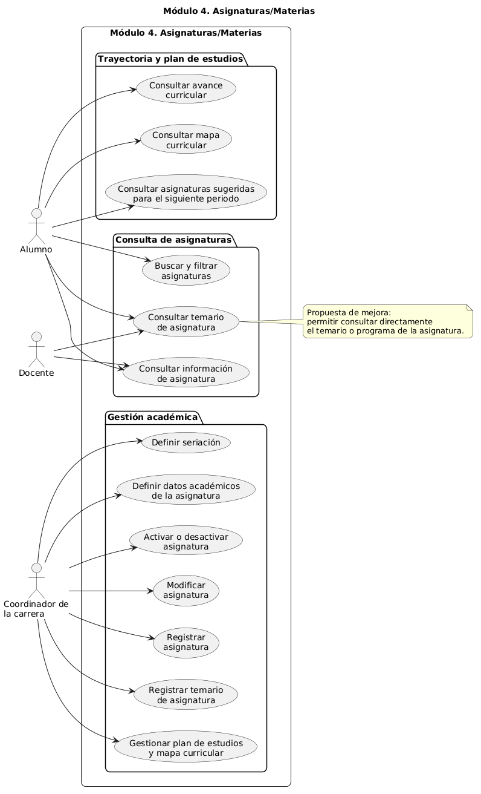
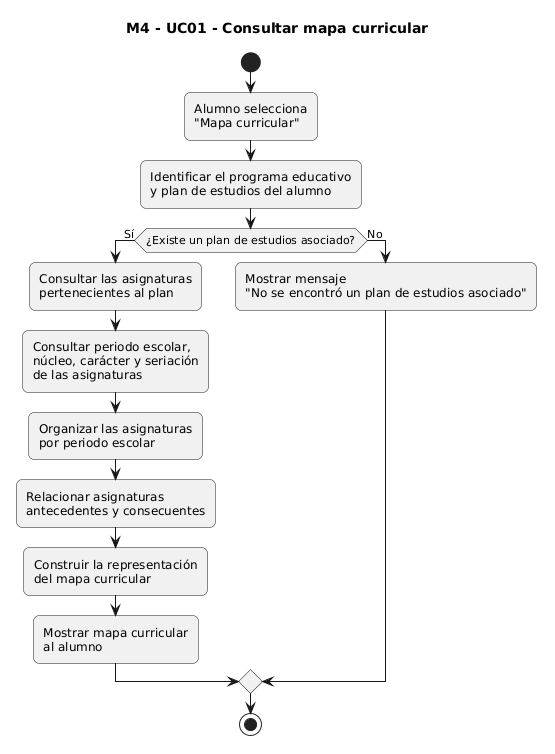
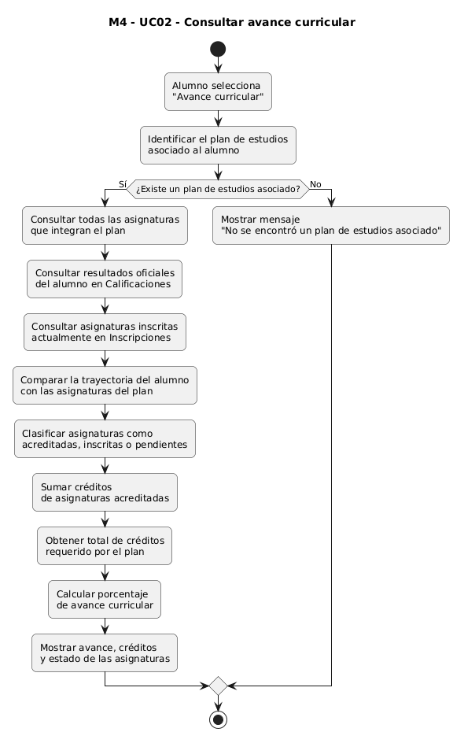
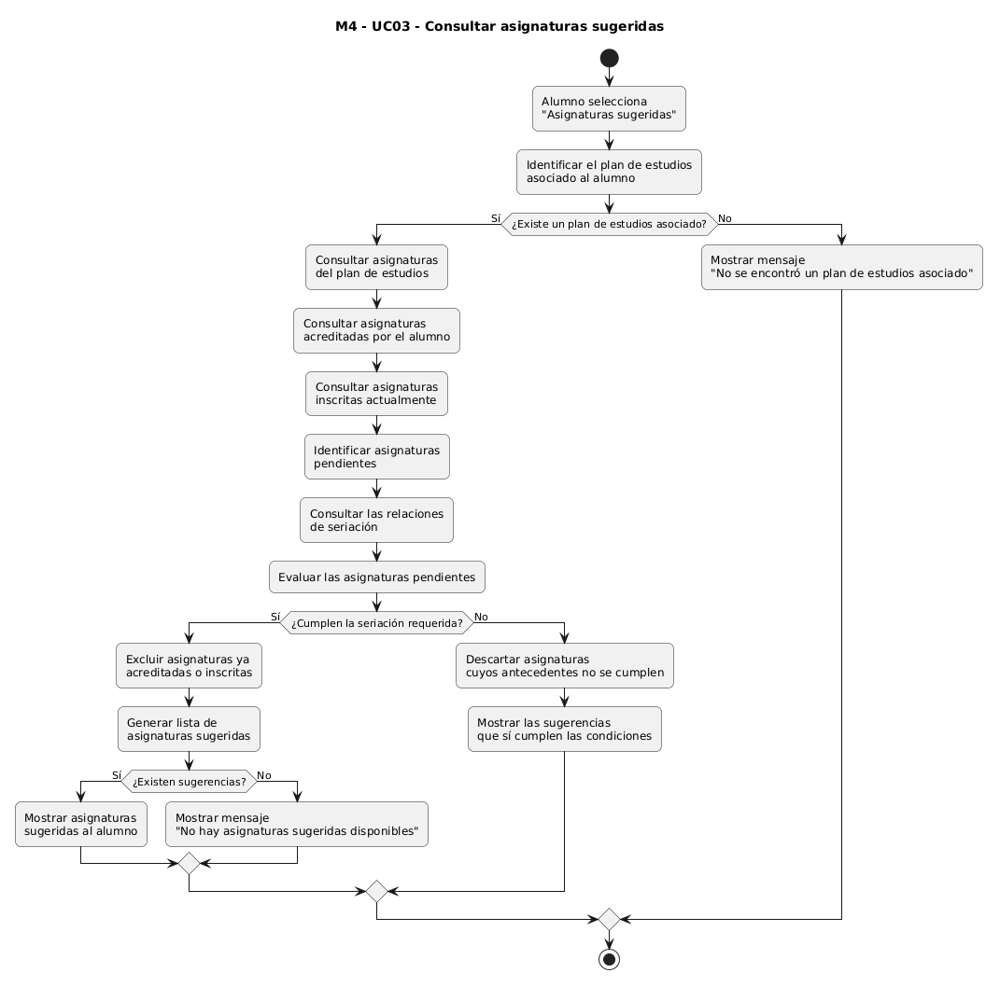
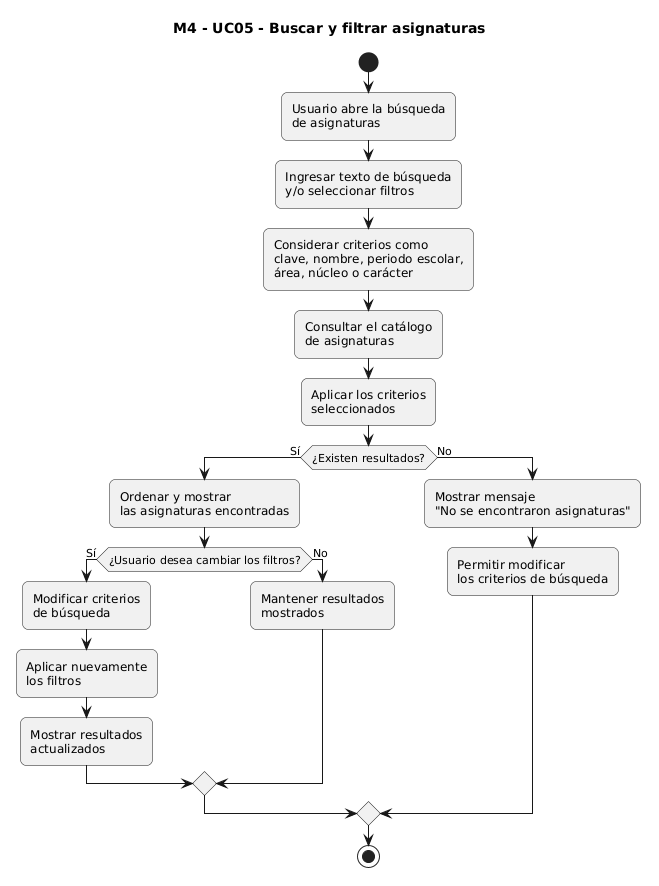
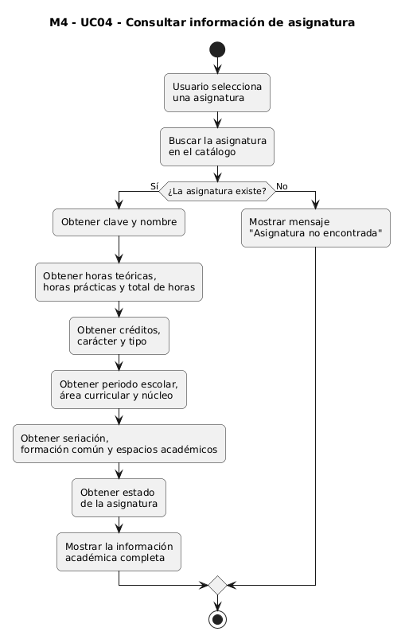
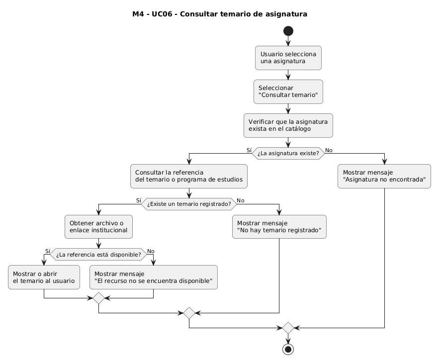

# Módulo 4: Asignaturas/Materias

> Equipo 4

---

# Tabla de contenido

- [Resumen](#resumen)
- [Definición de una asignatura o materia](#definición-de-una-asignatura-o-materia)
- [Objetivo y Alcance](#objetivo-y-alcance)
- [Requerimientos funcionales](#requerimientos-funcionales)
- [Actores](#actores)
- [Diagrama de casos de uso](#diagrama-de-casos-de-uso)
- [Diagrama de componentes](#diagrama-de-componentes)
- [Diagrama de actividades](#diagrama-de-actividades)
- [Diagrama de secuencia](#diagrama-de-secuencia)
- [Diagrama de estados](#diagrama-de-estados)
- [Diagrama de clases](#diagrama-de-clases)
- [Glosario y Abreviaturas](#glosario-y-abreviaturas)
- [Requerimientos No funcionales](#requerimientos-no-funcionales)

---

# Resumen

El módulo de **Asignaturas/Materias** permite consultar y administrar la información académica de las unidades de aprendizaje de un programa educativo, incluyendo el mapa curricular, el avance curricular, las asignaturas sugeridas para el siguiente periodo y la información propia de cada asignatura.

También permite mantener la estructura académica del plan de estudios mediante el registro y modificación de asignaturas, la definición de sus datos académicos, su seriación y la asociación de su temario o programa de estudios.

# Definición de una asignatura o materia

Una **asignatura**, **materia** o **unidad de aprendizaje (U.A.)** es una unidad académica que forma parte del plan de estudios de un programa educativo.

**Ejemplo:** Álgebra Lineal y Ensambladores son asignaturas pertenecientes al programa educativo de Ingeniería en Computación (ICO-F19).

Cada asignatura posee información que permite identificarla, conocer su carga académica y ubicarla dentro de la estructura curricular. Los programas de estudio institucionales muestran de manera recurrente datos como la clave, el nombre de la unidad de aprendizaje, las horas teóricas y prácticas, los créditos, el carácter, el tipo, el periodo escolar, el área curricular, el núcleo de formación y la seriación.

**Datos y metadatos principales de una asignatura**

| Dato | Tipo conceptual | Descripción | Regla o condición |
|---|---|---|---|
| **Clave** | Texto | Identificador institucional de la unidad de aprendizaje. | Debe identificar de forma única a la asignatura dentro del catálogo correspondiente. |
| **Nombre** | Texto | Nombre oficial de la asignatura o unidad de aprendizaje. | Es obligatorio. |
| **Horas teóricas** | Número entero | Horas destinadas al desarrollo teórico de la asignatura. | Deben ser iguales o mayores que cero. |
| **Horas prácticas** | Número entero | Horas destinadas a actividades prácticas. | Deben ser iguales o mayores que cero. |
| **Total de horas** | Número entero | Carga horaria total de la unidad de aprendizaje. | Debe ser consistente con las horas teóricas y prácticas registradas. |
| **Créditos** | Número entero | Valor académico asignado a la unidad de aprendizaje. | Debe corresponder al valor definido en el plan de estudios. |
| **Carácter** | Catálogo | Clasificación de la asignatura. **Ejemplo:** Obligatoria u optativa. | Debe pertenecer a los valores definidos por el plan. |
| **Tipo** | Catálogo | Forma académica de la unidad de aprendizaje. **Ejemplo:** Curso, taller o curso-taller. | Debe corresponder a un tipo válido. |
| **Periodo escolar** | Catálogo | Periodo del plan en el que se ubica la asignatura. **Ejemplo:** Séptimo u Octavo. | Debe corresponder a la estructura del plan de estudios. |
| **Área curricular** | Catálogo | Área académica o disciplinaria a la que pertenece la asignatura. **Ejemplo:** Ciencias Sociales y Humanidades. | Debe estar definida dentro del programa educativo. |
| **Núcleo de formación** | Catálogo | Clasificación de la asignatura dentro del plan. **Ejemplo:** Básico, sustantivo o integral. | Debe pertenecer a los núcleos definidos por el plan. |
| **U.A. antecedente** | Referencia a asignatura | Unidad de aprendizaje que antecede a otra dentro de una relación de seriación. | Puede no existir. |
| **U.A. consecuente** | Referencia a asignatura | Unidad de aprendizaje relacionada como continuación dentro de la seriación. | Puede no existir. |
| **Formación común** | Relación / catálogo | Indica si la unidad de aprendizaje es compartida con otros programas educativos. | Puede no aplicar. |
| **Espacio académico** | Relación / catálogo | Espacio académico en el que la unidad de aprendizaje puede impartirse. | Una asignatura puede estar disponible en más de un espacio académico. |
| **Estado** | Estado | Indica si la asignatura se encuentra activa o inactiva dentro del catálogo. | Una asignatura inactiva conserva su información histórica. |

> **Nota:** Grupo, aula, horario, docente asignado y modalidad de impartición corresponden a la oferta de una asignatura en un periodo determinado y no a la definición base de la materia. **Por esta razón, estos datos no se contemplan dentro de la definición principal de una asignatura en este módulo.**

# Objetivo y Alcance

El objetivo del módulo es facilitar la consulta y administración de la información académica de las asignaturas y su relación con el plan de estudios.

El módulo contempla:

- Consulta del mapa curricular.
- Consulta del avance curricular.
- Consulta de asignaturas sugeridas para el siguiente periodo.
- Consulta de información de las asignaturas.
- Búsqueda y filtrado de asignaturas.
- Consulta del temario o programa de una asignatura.
- Registro y modificación de asignaturas.
- Activación o desactivación de asignaturas.
- Definición de datos académicos y seriación.
- Gestión del plan de estudios y mapa curricular.
- Registro del temario o programa de una asignatura.

# Requerimientos funcionales

| ID | Requerimiento |
|---|---|
| **RF01** | El sistema deberá permitir al alumno consultar el mapa curricular de su programa educativo. |
| **RF02** | El sistema deberá permitir al alumno consultar su avance curricular mediante el estado de las asignaturas de su plan de estudios. |
| **RF03** | El sistema deberá mostrar al alumno las asignaturas sugeridas para el siguiente periodo. |
| **RF04** | El sistema deberá permitir consultar la información académica de una asignatura. |
| **RF05** | El sistema deberá permitir buscar y filtrar asignaturas utilizando criterios disponibles, como clave, nombre, periodo escolar, área curricular, núcleo o carácter. |
| **RF06** | El sistema deberá permitir al alumno y al docente consultar el temario o programa de una asignatura. |
| **RF07** | El sistema deberá permitir al coordinador de la carrera registrar una asignatura. |
| **RF08** | El sistema deberá permitir al coordinador de la carrera modificar la información de una asignatura. |
| **RF09** | El sistema deberá permitir al coordinador de la carrera activar o desactivar una asignatura sin eliminar su información histórica. |
| **RF10** | El sistema deberá permitir al coordinador definir los datos académicos de una asignatura, como horas teóricas, horas prácticas, créditos, carácter, tipo, área curricular, núcleo y periodo escolar. |
| **RF11** | El sistema deberá permitir al coordinador definir la seriación de las asignaturas. |
| **RF12** | El sistema deberá permitir al coordinador gestionar la organización de las asignaturas dentro del plan de estudios y mapa curricular. |
| **RF13** | El sistema deberá permitir al coordinador registrar el archivo o enlace institucional correspondiente al temario o programa de estudios de una asignatura. |

# Actores

| Actor | ¿Qué representa? | Funciones dentro del módulo |
|---|---|---|
| **Alumno** | Estudiante inscrito en un programa educativo. | Consulta el mapa curricular, su avance curricular, asignaturas sugeridas, información académica de las materias y temarios. |
| **Docente** | Personal académico encargado de impartir una o más asignaturas. | Consulta la información académica y el temario o programa de las asignaturas. |
| **Coordinador de la carrera** | Responsable académico de supervisar y mantener la estructura curricular del programa educativo. | Registra y modifica asignaturas, administra su estado, define datos académicos y seriación, organiza el plan de estudios y registra temarios o enlaces institucionales. |

# Diagrama de casos de uso

Representa las funciones principales del módulo y los actores que interactúan con ellas.

**Código fuente:** [Archivo UML del diagrama de casos de uso](../docs/architecture/diagrams/e4_m4_asignaturas_casos_uso.uml)

# Diagrama de componentes

Representa los componentes que participan en las funcionalidades del módulo y sus relaciones. Se muestra un diagrama por cada caso de uso.

# Diagrama de actividades

Representa el flujo de acciones y decisiones de cada funcionalidad. Se muestra un diagrama por cada caso de uso.

## Alumno

### UC01: Consultar mapa curricular

**Código fuente:** [Diagrama de actividades UC01](../docs/architecture/diagrams/e4_m4_uc01_diagrama_actividad.uml)

### UC02: Consultar avance curricular

**Código fuente:** [Diagrama de actividades UC02](../docs/architecture/diagrams/e4_m4_uc02_diagrama_actividad.uml)

### UC03: Consultar asignaturas sugeridas

**Código fuente:** [Diagrama de actividades UC03](../docs/architecture/diagrams/e4_m4_uc03_diagrama_actividad.uml)

### UC05: Buscar y filtrar asignaturas

**Código fuente:** [Diagrama de actividades UC05](../docs/architecture/diagrams/e4_m4_uc05_diagrama_actividad.uml)

## Alumno y Docente

### UC04: Consultar información de asignatura

**Código fuente:** [Diagrama de actividades UC04](../docs/architecture/diagrams/e4_m4_uc04_diagrama_actividad.uml)

### UC06: Consultar temario de asignatura

**Código fuente:** [Diagrama de actividades UC06](../docs/architecture/diagrams/e4_m4_uc06_diagrama_actividad.uml)

## Coordinador de la carrera

### UC07: Registrar asignatura

**Código fuente:** [Diagrama de actividades UC07](../docs/architecture/diagrams/e4_m4_uc07_diagrama_actividad.uml)

### UC08: Modificar asignatura

**Código fuente:** [Diagrama de actividades UC08](../docs/architecture/diagrams/e4_m4_uc08_diagrama_actividad.uml)

### UC09: Activar o desactivar asignatura

**Código fuente:** [Diagrama de actividades UC09](../docs/architecture/diagrams/e4_m4_uc09_diagrama_actividad.uml)

### UC10: Definir datos académicos

**Código fuente:** [Diagrama de actividades UC10](../docs/architecture/diagrams/e4_m4_uc10_diagrama_actividad.uml)

### UC11: Definir seriación

**Código fuente:** [Diagrama de actividades UC11](../docs/architecture/diagrams/e4_m4_uc11_diagrama_actividad.uml)

### UC12: Gestionar plan de estudios y mapa curricular

**Código fuente:** [Diagrama de actividades UC12](../docs/architecture/diagrams/e4_m4_uc12_diagrama_actividad.uml)

### UC13: Registrar temario de asignatura

**Código fuente:** [Diagrama de actividades UC13](../docs/architecture/diagrams/e4_m4_uc13_diagrama_actividad.uml)

# Diagrama de secuencia

Representa el orden de interacción entre los actores y componentes del sistema. Se muestra un diagrama por cada caso de uso.

# Diagrama de estados

Representa los cambios de estado de los objetos principales del módulo. Se muestran los diagramas correspondientes a los objetos que poseen un ciclo de vida relevante.

# Diagrama de clases

Representa las clases principales del módulo, sus atributos y las relaciones entre ellas.

# Glosario y Abreviaturas

| Término | Definición |
|---|---|
| **Asignatura / Materia / U.A.** | Unidad de aprendizaje que forma parte del plan de estudios de un programa educativo. |
| **Programa educativo** | Carrera o programa académico al que pertenece un plan de estudios. |
| **Plan de estudios** | Estructura académica que define y organiza las unidades de aprendizaje de un programa educativo. |
| **Mapa curricular** | Representación de las asignaturas que integran un plan de estudios y su organización por periodos. |
| **Seriación** | Relación académica que establece una secuencia entre determinadas unidades de aprendizaje. |
| **Carga académica** | Conjunto de horas y créditos asociados a una unidad de aprendizaje. |
| **Carácter** | Clasificación de una asignatura, por ejemplo obligatoria u optativa. |
| **Tipo** | Forma académica de una unidad de aprendizaje, por ejemplo curso, taller o curso-taller. |
| **Área curricular** | Área académica o disciplinaria a la que pertenece una asignatura. |
| **Núcleo de formación** | Clasificación de una unidad de aprendizaje dentro de los núcleos básico, sustantivo o integral. |
| **Periodo escolar** | Periodo del plan de estudios en el que se ubica una asignatura, por ejemplo Séptimo u Octavo. |
| **Temario / Programa de estudios** | Documento institucional que contiene la identificación, objetivos, contenidos y organización de una unidad de aprendizaje. |
| **Avance curricular** | Progreso del alumno dentro de su plan de estudios de acuerdo con el estado de sus asignaturas. |
| **Asignatura sugerida** | Materia que puede recomendarse al alumno para un periodo posterior de acuerdo con su situación académica y el plan de estudios. |
| **RF** | Requerimiento funcional. |
| **RNF** | Requerimiento no funcional. |
| **UC** | Caso de uso (*Use Case*). |
| **UML** | Lenguaje Unificado de Modelado (*Unified Modeling Language*). |

# Requerimientos No funcionales

| ID | Categoría | Requerimiento |
|---|---|---|
| **RNF01** | Usabilidad | La información de las asignaturas y del mapa curricular deberá presentarse de forma clara y comprensible para los usuarios. |
| **RNF02** | Rendimiento | Las consultas, búsquedas y filtros de asignaturas deberán responder en un tiempo adecuado bajo condiciones normales de uso. |
| **RNF03** | Seguridad | El sistema deberá restringir las funciones de modificación del catálogo y del plan de estudios a usuarios autorizados. |
| **RNF04** | Integridad | El sistema deberá conservar la consistencia de la información académica al modificar asignaturas, seriaciones o el plan de estudios. |
| **RNF05** | Disponibilidad | La información de las asignaturas deberá estar disponible para consulta durante los periodos en que los usuarios requieran acceder al sistema. |
| **RNF06** | Mantenibilidad | La estructura del módulo deberá permitir actualizar asignaturas, planes de estudio y temarios sin afectar innecesariamente otros módulos. |
