# Módulo Calendario de Exámenes

>
> Equipo 5
> (Jorge Uriel Vidal Morales, Melany Joana Toledo Escamilla, Alan Daniel Salas Gutierrez, Samuel Riveroll Vargas)
>

## Resumen
El **Módulo de Calendario de Exámenes** es la base para la planificación, organización y publicación de las evaluaciones académicas dentro del sistema de control escolar universitario. Su objetivo principal es automatizar y gestionar la programación de los diferentes tipos de evaluaciones (parciales, ordinarios, extraordinarios y título de suficiencia), garantizando la disponibilidad de aulas, evitando el traslape de horarios para alumnos y docentes, y facilitando la consulta centralizada en tiempo real.

## Objetivo y Alcance
### Objetivo
Automatizar y gestionar la planificación, organización y publicación de las evaluaciones académicas, asegurando la disponibilidad de espacios y evitando cruces de horarios para la comunidad estudiantil y docente.

### Alcance
Comprende la definición de periodos de evaluación, asignación de fechas, horarios y aulas, detección automática de conflictos por traslapes, publicación de calendarios y consultas personalizadas para alumnos, profesores y administradores.

## Requerimientos funcionales 
1. **RF-01 Programación de Periodos de Exámenes:** Permitir a la administración definir las ventanas de fechas hábiles para exámenes parciales y finales según el calendario lectivo.
2. **RF-02 Asignación de Horarios y Aulas:** Permitir la asignación de fecha, hora inicio/fin y aula física o virtual para cada asignatura.
3. **RF-03 Detección Automática de Conflictos (Validación de Traslape):** Validar que ningún estudiante o profesor tenga dos exámenes programados en el mismo bloque horario.
4. **RF-04 Consulta Personalizada del Estudiante:** Visualización del calendario de exámenes individual filtrado por la carga académica inscrita del alumno.
5. **RF-05 Consulta del Docente / Aplicador:** Visualización del calendario de aplicación de exámenes asignados y lista de asistencia.

### Actores
| Actor | Descripción |
|---|---|
| Administrador / Coordinador | Personal administrativo o académico autorizado para gestionar la programación de evaluaciones dentro del sistema de control escolar. Es responsable de organizar los calendarios de exámenes conforme a los periodos y lineamientos académicos establecidos. |
| Alumno | Estudiante inscrito en un programa educativo de la UAEMéx, con una carga académica registrada en el sistema. Es el usuario al que corresponde la información de las evaluaciones de sus asignaturas. |
| Profesor / Aplicador | Personal académico autorizado para aplicar o supervisar evaluaciones. Se encuentra vinculado a las asignaturas o grupos que tiene asignados y es responsable de la aplicación de los exámenes correspondientes. |


## Diagrama de casos de uso

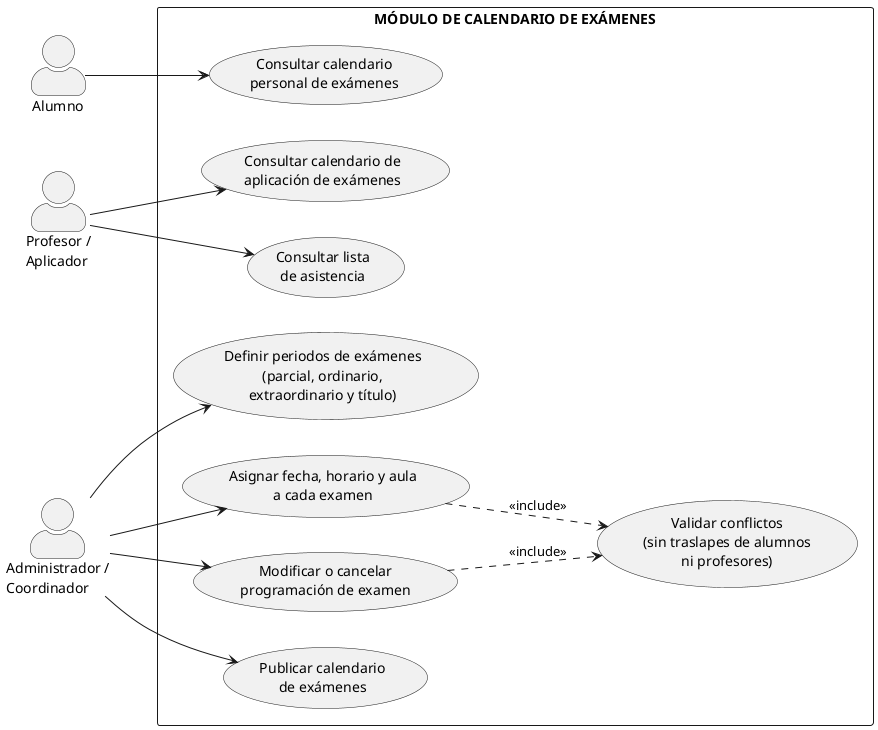
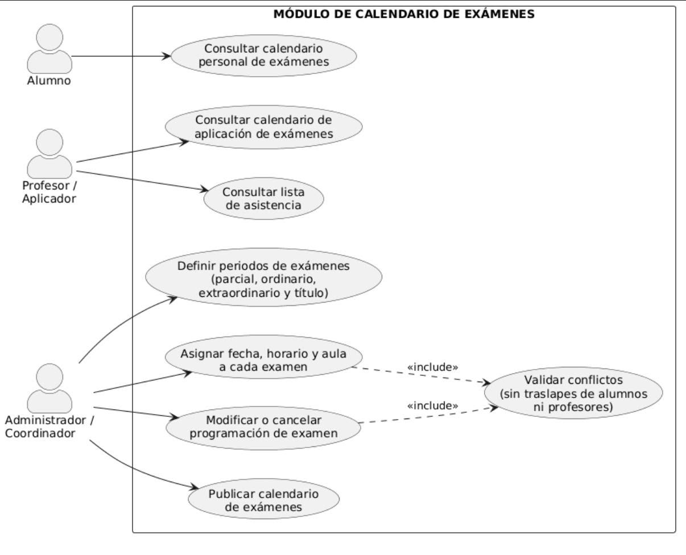

## Descripción
- **UC1: Definir periodos de exámenes:** Permite al Administrador/Coordinador establecer las ventanas de fechas hábiles para las distintas evaluaciones académicas (parciales, ordinarios, extraordinarios y título de suficiencia).
  
- **UC2: Asignar fecha, horario y aula a cada examen:** Permite fijar los parámetros espacio-temporales para la aplicación de cada evaluación dentro del calendario lectivo.
  
- **UC3: Validar conflictos (sin traslapes) `<<include>>`:** Proceso automatizado ejecutado durante la asignación o modificación para garantizar que ningún alumno o docente tenga evaluaciones empalmadas en el mismo bloque de tiempo.
  
- **UC4: Modificar o cancelar programación de examen:** Permite ajustar parámetros o suspender evaluaciones previamente registradas actualizando el estado de la agenda.
  
- **UC5: Publicar calendario de exámenes:** Hace oficial la programación para que quede disponible para consulta pública dentro del sistema.
  
- **UC6: Consultar calendario personal de exámenes:** Permite al Alumno visualizar las fechas, horarios y aulas asignadas únicamente para las asignaturas en las que se encuentra inscrito.
  
- **UC7: Consultar calendario de aplicación de exámenes:** Muestra al Profesor/Aplicador el cronograma de los exámenes donde participará como responsable o aplicador.
  
- **UC8: Consultar lista de asistencia:** Permite al Profesor/Aplicador obtener la relación oficial de alumnos habilitados para presentar la evaluación en el aula correspondiente.


##  Diagramas de Contexto (Nivel 0 y Nivel 1)
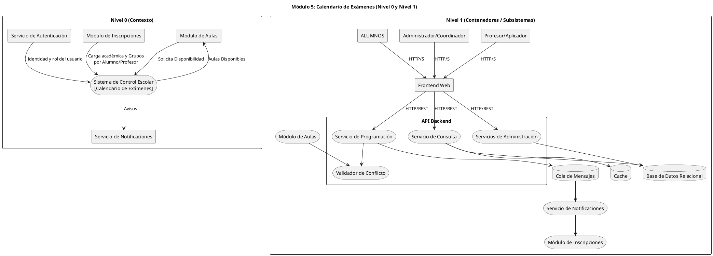
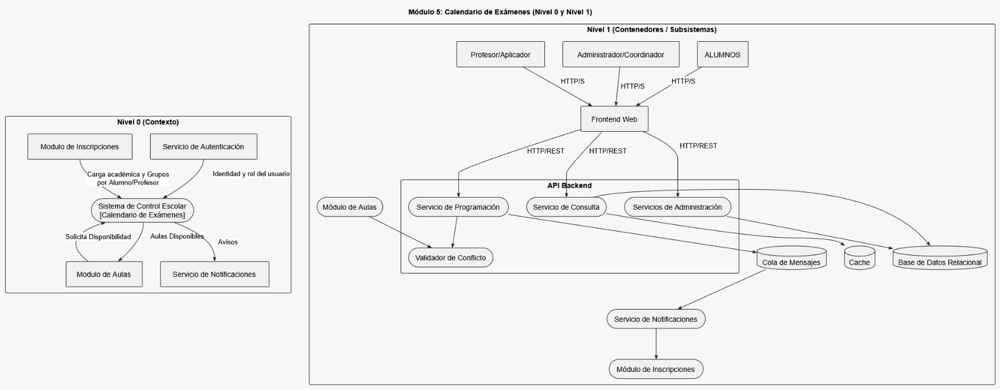

## Descripción
### Diagrama de Nivel 0 (Contexto)

- **Módulo de Aulas:** Mantiene una comunicación bidireccional solicitando disponibilidad de espacios y devolviendo el catálogo de aulas activas e instaladas.
  
- **Módulo de Inscripciones:** Provee la carga académica de asignaturas y la lista de grupos asociados tanto a alumnos como a docentes.
  
- **Servicio de Autenticación:** Transmite la validación de identidad y el rol activo del usuario para determinar los permisos de operación dentro del sistema.
  
- **Sistema de Control Escolar (Calendario de Exámenes):** Procesa los datos recibidos para programar las evaluaciones y coordinar los recursos.
  
- **Servicio de Notificaciones:** Recibe la emisión de avisos y alertas del calendario para distribuirlos a los usuarios involucrados.
  

### Diagrama de Nivel 1 (Contenedores / Subsistemas)

- **Actores (Profesor/Aplicador, Administrador/Coordinador, ALUMNOS):** Interfazan con el sistema mediante peticiones seguras (`HTTP/S`) hacia la capa cliente.
  
- **Frontend Web:** Captura las interacciones de los usuarios y distribuye las peticiones mediante llamadas `HTTP/REST` hacia los servicios backend.
  
- **Servicios de Administración:** Gestionan la persistencia de configuraciones, modificaciones de periodos y parámetros.
  
  
- **Servicio de Programación:** Registra los eventos de examen, coordina la validación de espacios y publica eventos hacia la Cola de Mensajes.
  
- **Validador de Conflicto:** Proceso automatizado que interactúa con el Módulo de Aulas para asegurar la disponibilidad sin cruce de horarios.
  
- **Cola de Mensajes & Notificaciones:** Asincroniza la entrega de eventos hacia el Servicio de Notificaciones.

## Diagrama de componentes

Nota: Se incluye un diagrama por caso de uso.

### UC1. Definir periodos de exámenes

**Descripción:** El diagrama de componentes identifica los participantes y dependencias necesarios para el caso UC1. El administrador configura las ventanas de evaluación dentro de un periodo escolar existente. El gestor consulta el periodo vigente y los tipos de examen, valida las fechas y conserva la ventana de evaluación; no crea ni modifica periodos escolares.

**Código fuente UML:** [Ver archivo m5_uc1_componentes.puml](../docs/architecture/diagrams/m5_uc1_componentes.puml)

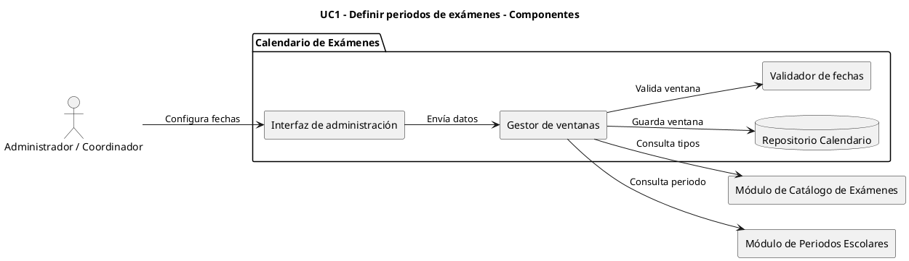

**Imagen visible:**


---

### UC2. Asignar fecha, horario y aula

**Descripción:** El diagrama de componentes identifica los participantes y dependencias necesarios para el caso UC2. El administrador selecciona materia, grupo, tipo de examen, profesor, horario y aula. El gestor consulta los módulos académicos y ejecuta UC3; únicamente cuando los datos son válidos solicita la asignación del espacio y registra el examen como programado.

**Código fuente UML:** [Ver archivo m5_uc2_componentes.puml](../docs/architecture/diagrams/m5_uc2_componentes.puml)

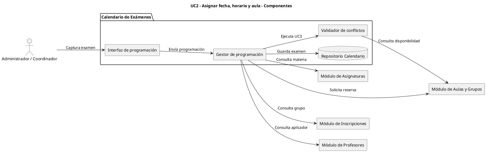

**Imagen visible:**


---

### UC3. Validar conflictos de programación

**Descripción:** El diagrama de componentes identifica los participantes y dependencias necesarios para el caso UC3. El validador cruza el intervalo propuesto con los exámenes vigentes del mismo alumnado y profesorado. Solicita al Módulo de Aulas y Grupos la comprobación de disponibilidad y aforo, y devuelve los motivos concretos de rechazo, si existen. Este caso se invoca desde UC2 y UC4.

**Código fuente UML:** [Ver archivo m5_uc3_componentes.puml](../docs/architecture/diagrams/m5_uc3_componentes.puml)

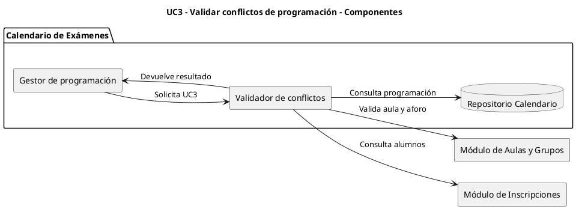

**Imagen visible:**


---

### UC4. Modificar programación de examen

**Descripción:** El diagrama de componentes identifica los participantes y dependencias necesarios para el caso UC4. El administrador recupera una programación existente y propone cambios. El gestor comprueba permisos y estado, vuelve a ejecutar UC3, solicita la actualización de la reserva al Módulo de Aulas y Grupos y confirma el cambio en el calendario. La actualización debe preservar la consistencia entre ambos módulos.

**Código fuente UML:** [Ver archivo m5_uc4_componentes.puml](../docs/architecture/diagrams/m5_uc4_componentes.puml)

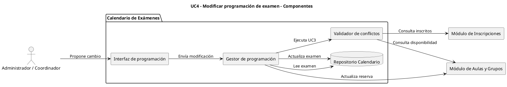

**Imagen visible:**


---

### UC5. Cancelar programación de examen

**Descripción:** El diagrama de componentes identifica los participantes y dependencias necesarios para el caso UC5. El administrador selecciona un examen vigente y confirma la cancelación. El sistema marca el registro como cancelado, solicita liberar la reserva vinculada en Aulas y Grupos y conserva el historial. No se necesita ejecutar la validación de traslapes para cancelar.

**Código fuente UML:** [Ver archivo m5_uc5_componentes.puml](../docs/architecture/diagrams/m5_uc5_componentes.puml)

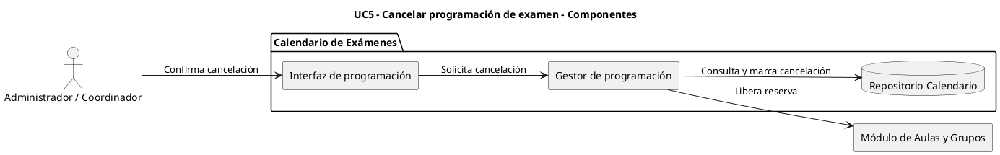

**Imagen visible:**


---

### UC6. Publicar calendario de exámenes

**Descripción:** El diagrama de componentes identifica los participantes y dependencias necesarios para el caso UC6. El administrador solicita publicar programaciones revisadas. El gestor verifica que los registros sean válidos y publicables, cambia su estado a publicado y habilita su consulta para alumnos y profesores autorizados. No se presupone un servicio de notificaciones.

**Código fuente UML:** [Ver archivo m5_uc6_componentes.puml](../docs/architecture/diagrams/m5_uc6_componentes.puml)

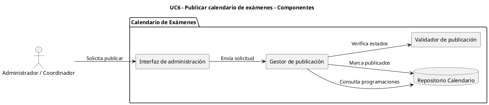

**Imagen visible:**


---

### UC7. Consultar calendario personal de exámenes

**Descripción:** El diagrama de componentes identifica los participantes y dependencias necesarios para el caso UC7. El alumno autenticado solicita su calendario. El servicio de consultas obtiene su carga inscrita desde Inscripciones, filtra los exámenes publicados asociados a esos grupos y muestra fecha, horario, asignatura y aula. No permite consultar el calendario privado de otros alumnos.

**Código fuente UML:** [Ver archivo m5_uc7_componentes.puml](../docs/architecture/diagrams/m5_uc7_componentes.puml)

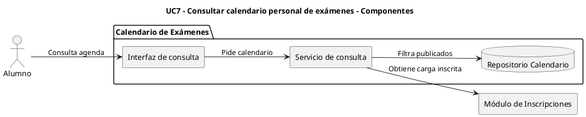

**Imagen visible:**


---

### UC8. Consultar calendario de aplicación de exámenes

**Descripción:** El diagrama de componentes identifica los participantes y dependencias necesarios para el caso UC8. El profesor autenticado solicita los exámenes en los que figura como responsable. El servicio consulta sus asignaciones y recupera las programaciones publicadas, mostrando materia, grupo, fecha, horario y aula. Solo presenta sus propias asignaciones.

**Código fuente UML:** [Ver archivo m5_uc8_componentes.puml](../docs/architecture/diagrams/m5_uc8_componentes.puml)

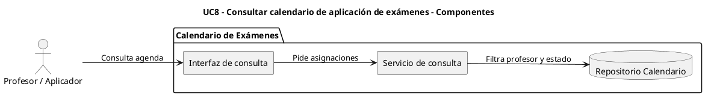

**Imagen visible:**


---

### UC9. Consultar lista de asistencia

**Descripción:** El diagrama de componentes identifica los participantes y dependencias necesarios para el caso UC9. El profesor elige uno de sus exámenes asignados. El sistema verifica esa asignación, obtiene los alumnos inscritos en el grupo y consulta los criterios de elegibilidad aplicables desde Catálogo de Exámenes o el módulo responsable. Muestra una lista para consulta, sin capturar asistencia ni calificaciones.

**Código fuente UML:** [Ver archivo m5_uc9_componentes.puml](../docs/architecture/diagrams/m5_uc9_componentes.puml)

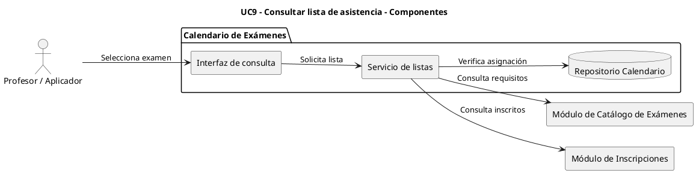

**Imagen visible:**


---

## Diagrama de secuencia

Nota: Se incluye un diagrama por caso de uso.

### UC1. Definir periodos de exámenes

**Descripción:** El diagrama de secuencia ordena las solicitudes, respuestas y decisiones del caso UC1. El administrador configura las ventanas de evaluación dentro de un periodo escolar existente. El gestor consulta el periodo vigente y los tipos de examen, valida las fechas y conserva la ventana de evaluación; no crea ni modifica periodos escolares. Las ramas alternativas muestran cuándo se rechaza o no se completa una operación.

**Código fuente UML:** [Ver archivo m5_uc1_secuencia.puml](../docs/architecture/diagrams/m5_uc1_secuencia.puml)

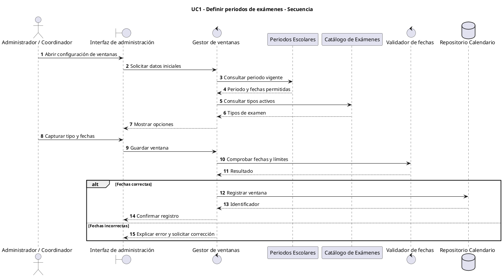

**Imagen visible:**


---

### UC2. Asignar fecha, horario y aula

**Descripción:** El diagrama de secuencia ordena las solicitudes, respuestas y decisiones del caso UC2. El administrador selecciona materia, grupo, tipo de examen, profesor, horario y aula. El gestor consulta los módulos académicos y ejecuta UC3; únicamente cuando los datos son válidos solicita la asignación del espacio y registra el examen como programado. Las ramas alternativas muestran cuándo se rechaza o no se completa una operación.

**Código fuente UML:** [Ver archivo m5_uc2_secuencia.puml](../docs/architecture/diagrams/m5_uc2_secuencia.puml)

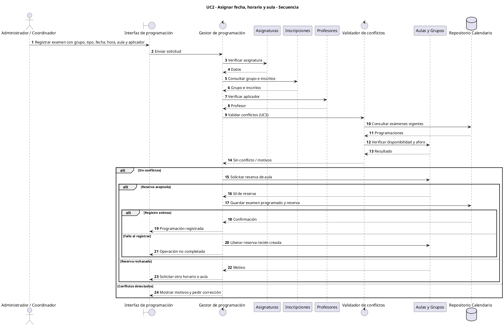

**Imagen visible:**


---

### UC3. Validar conflictos de programación

**Descripción:** El diagrama de secuencia ordena las solicitudes, respuestas y decisiones del caso UC3. El validador cruza el intervalo propuesto con los exámenes vigentes del mismo alumnado y profesorado. Solicita al Módulo de Aulas y Grupos la comprobación de disponibilidad y aforo, y devuelve los motivos concretos de rechazo, si existen. Este caso se invoca desde UC2 y UC4. Las ramas alternativas muestran cuándo se rechaza o no se completa una operación.

**Código fuente UML:** [Ver archivo m5_uc3_secuencia.puml](../docs/architecture/diagrams/m5_uc3_secuencia.puml)

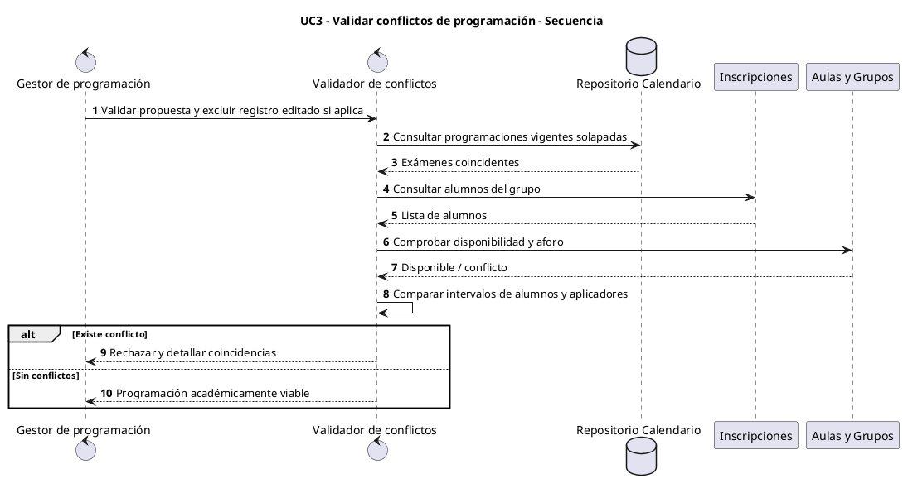

**Imagen visible:**


---

### UC4. Modificar programación de examen

**Descripción:** El diagrama de secuencia ordena las solicitudes, respuestas y decisiones del caso UC4. El administrador recupera una programación existente y propone cambios. El gestor comprueba permisos y estado, vuelve a ejecutar UC3, solicita la actualización de la reserva al Módulo de Aulas y Grupos y confirma el cambio en el calendario. La actualización debe preservar la consistencia entre ambos módulos. Las ramas alternativas muestran cuándo se rechaza o no se completa una operación.

**Código fuente UML:** [Ver archivo m5_uc4_secuencia.puml](../docs/architecture/diagrams/m5_uc4_secuencia.puml)

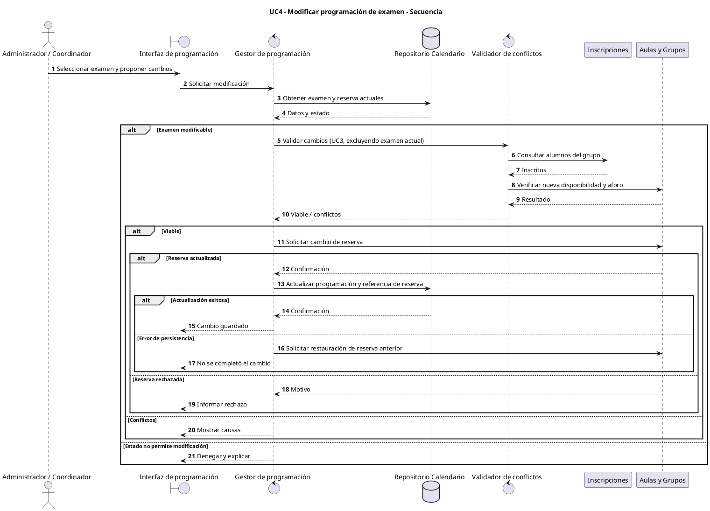

**Imagen visible:**


---

### UC5. Cancelar programación de examen

**Descripción:** El diagrama de secuencia ordena las solicitudes, respuestas y decisiones del caso UC5. El administrador selecciona un examen vigente y confirma la cancelación. El sistema marca el registro como cancelado, solicita liberar la reserva vinculada en Aulas y Grupos y conserva el historial. No se necesita ejecutar la validación de traslapes para cancelar. Las ramas alternativas muestran cuándo se rechaza o no se completa una operación.

**Código fuente UML:** [Ver archivo m5_uc5_secuencia.puml](../docs/architecture/diagrams/m5_uc5_secuencia.puml)

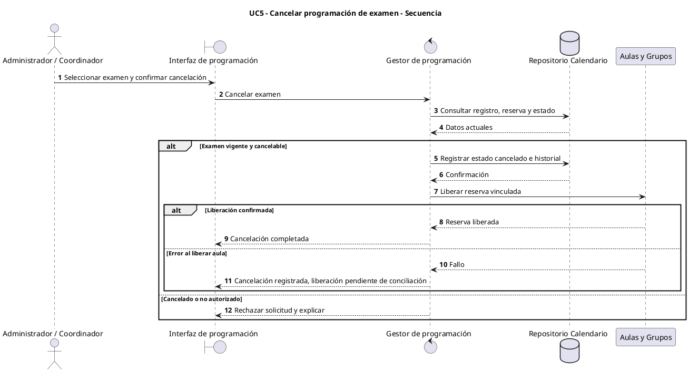

**Imagen visible:**


---

### UC6. Publicar calendario de exámenes

**Descripción:** El diagrama de secuencia ordena las solicitudes, respuestas y decisiones del caso UC6. El administrador solicita publicar programaciones revisadas. El gestor verifica que los registros sean válidos y publicables, cambia su estado a publicado y habilita su consulta para alumnos y profesores autorizados. No se presupone un servicio de notificaciones. Las ramas alternativas muestran cuándo se rechaza o no se completa una operación.

**Código fuente UML:** [Ver archivo m5_uc6_secuencia.puml](../docs/architecture/diagrams/m5_uc6_secuencia.puml)

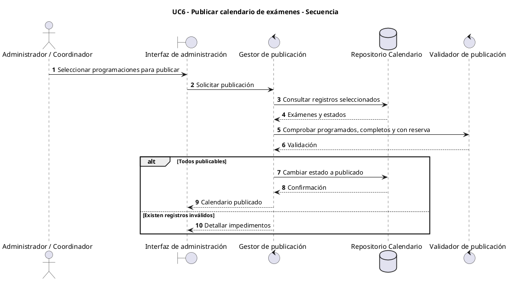

**Imagen visible:**


---

### UC7. Consultar calendario personal de exámenes

**Descripción:** El diagrama de secuencia ordena las solicitudes, respuestas y decisiones del caso UC7. El alumno autenticado solicita su calendario. El servicio de consultas obtiene su carga inscrita desde Inscripciones, filtra los exámenes publicados asociados a esos grupos y muestra fecha, horario, asignatura y aula. No permite consultar el calendario privado de otros alumnos. Las ramas alternativas muestran cuándo se rechaza o no se completa una operación.

**Código fuente UML:** [Ver archivo m5_uc7_secuencia.puml](../docs/architecture/diagrams/m5_uc7_secuencia.puml)

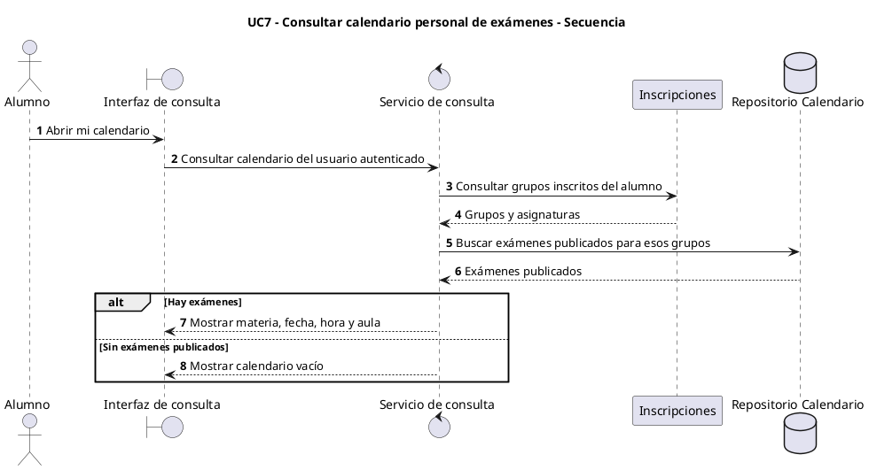

**Imagen visible:**


---

### UC8. Consultar calendario de aplicación de exámenes

**Descripción:** El diagrama de secuencia ordena las solicitudes, respuestas y decisiones del caso UC8. El profesor autenticado solicita los exámenes en los que figura como responsable. El servicio consulta sus asignaciones y recupera las programaciones publicadas, mostrando materia, grupo, fecha, horario y aula. Solo presenta sus propias asignaciones. Las ramas alternativas muestran cuándo se rechaza o no se completa una operación.

**Código fuente UML:** [Ver archivo m5_uc8_secuencia.puml](../docs/architecture/diagrams/m5_uc8_secuencia.puml)

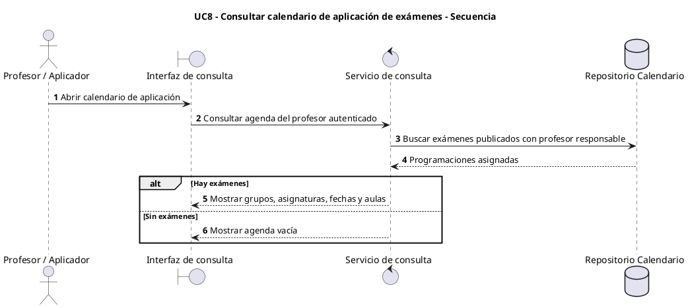

**Imagen visible:**


---

### UC9. Consultar lista de asistencia

**Descripción:** El diagrama de secuencia ordena las solicitudes, respuestas y decisiones del caso UC9. El profesor elige uno de sus exámenes asignados. El sistema verifica esa asignación, obtiene los alumnos inscritos en el grupo y consulta los criterios de elegibilidad aplicables desde Catálogo de Exámenes o el módulo responsable. Muestra una lista para consulta, sin capturar asistencia ni calificaciones. Las ramas alternativas muestran cuándo se rechaza o no se completa una operación.

**Código fuente UML:** [Ver archivo m5_uc9_secuencia.puml](../docs/architecture/diagrams/m5_uc9_secuencia.puml)

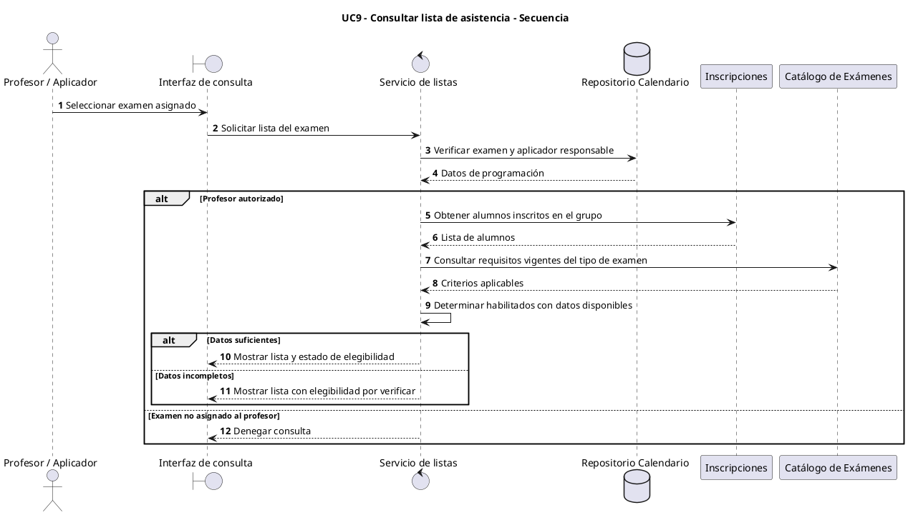

**Imagen visible:**


---

## Diagrama de estados

### Ciclo de vida de ExamenProgramado

**Descripción:** Se representan los estados Programado, Publicado, Realizado y Cancelado. Las modificaciones conservan un estado vigente y solo se permiten con autorización; la liberación de espacios pertenece al Módulo de Aulas y Grupos.

**Código fuente UML:** [Ver archivo m5_estados_examen.puml](../docs/architecture/diagrams/m5_estados_examen.puml)

```plantuml
@startuml m5_estados_examen
title Estados - Examen programado
[*] --> Programado : Crear examen y reservar aula
Programado --> Publicado : Publicar calendario
Programado --> Programado : Modificar y validar
Publicado --> Publicado : Modificar, validar y republicar [autorizado]

Programado --> Cancelado : Cancelar
Publicado --> Cancelado : Cancelar [autorizado]
Publicado --> Realizado : Fecha concluida y examen aplicado
Realizado --> [*]
Cancelado --> [*]
note right of Programado
Se conserva el historial de modificaciones.
La reserva es gestionada por Aulas y Grupos.
end note
@enduml
```

**Imagen visible:**


### Ciclo de vida de VentanaEvaluacion

**Descripción:** Una ventana de evaluación se configura con fechas coherentes, pasa a habilitada al comenzar su intervalo y finaliza al terminar. Su ciclo de vida es diferente al de un periodo escolar, administrado por el equipo 2.

**Código fuente UML:** [Ver archivo m5_estados_ventana.puml](../docs/architecture/diagrams/m5_estados_ventana.puml)

```plantuml
@startuml m5_estados_ventana
title Estados - Ventana de evaluación
[*] --> Configurada : Registrar fechas validas
Configurada --> Habilitada : Inicia intervalo
Configurada --> Configurada : Ajustar fechas validas
Habilitada --> Finalizada : Termina intervalo
Finalizada --> [*]
@enduml
```

**Imagen visible:**


## Diagrama de clases

### Estructura del módulo de Calendario de Exámenes

**Descripción:** El modelo identifica `ExamenProgramado` y `VentanaEvaluacion` como entidades propias del módulo, con servicios para programar, validar y consultar. Las asignaturas, grupos, docentes, reservas y tipos de examen aparecen como referencias externas, pues su información es administrada por otros equipos. Atributos, operaciones y estados son propuestas de diseño documental, no una descripción de clases ya implementadas.

**Código fuente UML:** [Ver archivo m5_clases_calendario.puml](../docs/architecture/diagrams/m5_clases_calendario.puml)

```plantuml
@startuml m5_clases_calendario
title Diagrama de clases - Calendario de Exámenes
skinparam classAttributeIconSize 0
class VentanaEvaluacion {
  +idVentana: UUID
  +fechaInicio: Date
  +fechaFin: Date
  +estado: EstadoVentana
  +validarFechas(): boolean
}
class ExamenProgramado {
  +idExamen: UUID
  +idAsignatura: UUID
  +idGrupo: UUID
  +idProfesor: UUID
  +idTipoExamen: UUID
  +fecha: Date
  +horaInicio: Time
  +horaFin: Time
  +idReservaAula: UUID
  +estado: EstadoExamen
  +programar(): void
  +modificar(): void
  +cancelar(): void
  +publicar(): void
}
class GestorProgramacion {
  +programarExamen(datos): Resultado
  +modificarExamen(id, datos): Resultado
  +cancelarExamen(id): Resultado
}
class ValidadorConflictos {
  +verificarAlumnos(grupo, intervalo): boolean
  +verificarProfesor(profesor, intervalo): boolean
  +verificarAula(aula, intervalo): boolean
}
class ServicioConsulta {
  +calendarioAlumno(id): Lista
  +calendarioProfesor(id): Lista
  +listaExamen(id): Lista
}
class ReferenciaAsignatura <<externo>> {
  +idAsignatura: UUID
}
class ReferenciaGrupo <<externo>> {
  +idGrupo: UUID
}
class ReferenciaProfesor <<externo>> {
  +idProfesor: UUID
}
class ReferenciaReservaAula <<externo>> {
  +idReserva: UUID
}
class ReferenciaTipoExamen <<externo>> {
  +idTipo: UUID
}
enum EstadoExamen {
  Programado
  Publicado
  Realizado
  Cancelado
}
enum EstadoVentana {
  Configurada
  Habilitada
  Finalizada
}
VentanaEvaluacion "1" o-- "0..*" ExamenProgramado : delimita
GestorProgramacion ..> ExamenProgramado : administra
GestorProgramacion ..> ValidadorConflictos : utiliza
ServicioConsulta ..> ExamenProgramado : consulta
ExamenProgramado --> EstadoExamen
VentanaEvaluacion --> EstadoVentana
ExamenProgramado --> ReferenciaAsignatura : id
ExamenProgramado --> ReferenciaGrupo : id
ExamenProgramado --> ReferenciaProfesor : id
ExamenProgramado --> ReferenciaReservaAula : id
ExamenProgramado --> ReferenciaTipoExamen : id
note bottom of ReferenciaGrupo
Referencias a información administrada por otros módulos.
No se duplican sus entidades completas.
end note
@enduml
```

**Imagen visible:**


---

## Consideraciones de integración

- **UC3** es el caso incluido desde UC2 y UC4; no existe un actor humano exclusivo para dispararlo.
- La reserva y liberación de espacios pertenece al módulo de Aulas y Grupos.
- La definición de periodos escolares pertenece a Periodos Escolares; UC1 administra solo ventanas de evaluación.
- Los tipos y criterios de examen pertenecen al Catálogo de Exámenes.
- Alumnos inscritos y carga académica se obtienen desde Inscripciones.
- La publicación y las consultas se restringen a usuarios autorizados.
- Los cambios de reserva y registro requieren una estrategia de consistencia y recuperación ante errores, por tratarse de dos módulos separados.


## Glosario y Abreviaturas
| Abreviatura / Término | Definición |
| :--- | :--- |
| **EX-PAR** | Examen Parcial: Evaluación periódica durante el semestre. |
| **EX-ORD** | Examen Ordinario: Evaluación final del curso regular. |
| **EX-EXT** | Examen Extraordinario: Evaluación de regularización para alumnos no acreditados. |
| **EX-TS** | Examen a Título de Suficiencia: Evaluación integral extraordinaria. |

## Requerimientos No funcionales
1. **RNF-01 Concurrencia:** Soportar la alta demanda de consultas por parte de los estudiantes al momento de la publicación del calendario.
