# Módulo Registro de Calificaciones

> Equipo 6  
> **Integrantes:** Luis Fernando Guerrero Pedroza; Tendzin Angello Diaz Estrada; Erick Daniel Rosales González; Gabriell Quetzalli Santana Reyes

## Resumen
Permite a los profesores pasar lista, capturar calificaciones y cerrar el acta de cada grupo. Control Escolar oficializa las actas y los alumnos consultan sus calificaciones o piden una revisión.

## Objetivo y Alcance
**Objetivo:** Registrar y consultar las calificaciones de cada alumno por grupo de forma ordenada y confiable.

**Alcance:** Captura de calificaciones (parciales, ordinario, extraordinario y título de suficiencia, o NP), registro de asistencia, cierre y oficialización de actas, consulta de calificaciones y solicitud de revisión. Las fechas de examen las programa el Calendario de Exámenes y los requisitos de cada examen los define el Catálogo de Exámenes.

## Requerimientos funcionales
- **RF-01:** Capturar calificaciones por grupo, o marcar NP si el alumno no se presentó.
- **RF-02:** Permitir la captura solo dentro de las fechas definidas por el módulo Periodos.
- **RF-03:** Registrar la asistencia de cada clase y calcular el porcentaje de asistencia de cada alumno.
- **RF-04:** Generar y cerrar el acta de calificaciones del grupo.
- **RF-05:** Oficializar el acta y avisar al módulo Asignaturas qué materias se acreditaron.
- **RF-06:** Consultar las calificaciones propias.
- **RF-07:** Solicitar la revisión de una calificación oficial.

### Relación entre requerimientos y casos de uso

Indica qué caso de uso cumple cada requerimiento funcional.

| Requerimiento | Caso de uso que lo cumple |
|---|---|
| RF-01 | UC01 Capturar calificaciones |
| RF-02 | UC01 Capturar calificaciones (incluye UC07 Validar fechas de captura) |
| RF-03 | UC02 Registrar asistencia |
| RF-04 | UC03 Cerrar acta (incluye UC08 Generar acta) |
| RF-05 | UC04 Oficializar acta |
| RF-06 | UC05 Consultar calificaciones |
| RF-07 | UC06 Solicitar revisión |

## Actores

Un **actor** es quien usa el módulo desde fuera. Aquí se define quién es cada uno; lo que hace se ve en el diagrama de casos de uso.

| Actor | ¿Quién es? | Rol en el diagrama de herencia |
|---|---|---|
| Profesor | Docente de la Facultad que tiene asignado al menos un grupo en el periodo actual (registrado en el módulo Profesores). | Profesor |
| Personal de Control Escolar | Empleado del área de Control Escolar de la Facultad, responsable de los registros oficiales de los alumnos. | AdministradorEscolar |
| Alumno | Estudiante de la Facultad inscrito en al menos un grupo del periodo actual (registrado en el módulo Alumnos). | Alumno |

## Diagrama de casos de uso

Un **diagrama de casos de uso** muestra qué puede hacer cada actor en el módulo. Cada óvalo es un caso de uso; `<<include>>` indica un paso que siempre se ejecuta dentro de otro caso.

Código fuente: [casos_uso.puml](./resources/uml/m8_calificaciones/casos_uso.puml)

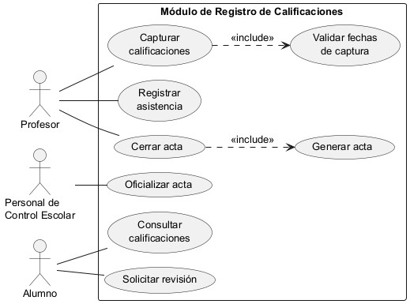

| ID | Caso de uso | Actor | Descripción |
|---|---|---|---|
| UC01 | Capturar calificaciones | Profesor | Captura la calificación o NP de cada alumno del grupo. |
| UC02 | Registrar asistencia | Profesor | Marca asistencia o falta en cada clase. |
| UC03 | Cerrar acta | Profesor | Genera el acta del grupo y la cierra. |
| UC04 | Oficializar acta | Personal de Control Escolar | Vuelve oficial un acta cerrada. |
| UC05 | Consultar calificaciones | Alumno | Muestra las calificaciones del alumno. |
| UC06 | Solicitar revisión | Alumno | Registra una solicitud de revisión que atiende el profesor de la materia. |

UC07 (Validar fechas de captura) y UC08 (Generar acta) se incluyen dentro de UC01 y UC03.

### Precondiciones y postcondiciones

La **precondición** es lo que debe ser cierto antes de empezar el caso de uso; la **postcondición** es cómo queda el sistema cuando termina bien.

| Caso | Precondición | Postcondición |
|---|---|---|
| UC01 | El profesor inició sesión, tiene asignado el grupo y el acta está *en captura*. | Las calificaciones (o NP) quedan guardadas. |
| UC02 | El profesor inició sesión y tiene asignado el grupo. | La asistencia queda guardada y se recalcula el porcentaje de cada alumno. |
| UC03 | El acta del grupo está *en captura*. | El acta queda *Cerrada* y ya no se puede editar. |
| UC04 | El acta está *Cerrada*. | El acta queda *Oficializada* y Asignaturas sabe qué materias se acreditaron. |
| UC05 | El alumno inició sesión. | Se muestran sus calificaciones; no se modifica nada. |
| UC06 | El alumno tiene una calificación *oficial* en esa materia. | La solicitud queda *Pendiente* con un folio y la atiende el profesor. |

## Diagramas de contexto

Los **diagramas de contexto** ubican al módulo dentro del sistema de Control Escolar. El nivel 1 muestra con qué actores y módulos intercambia información; el nivel 2 abre el módulo y muestra sus partes internas.

### Nivel 1

Código fuente: [e6_m8_calificaciones_contexto_nivel1.uml](../docs/architecture/diagrams/e6_m8_calificaciones_contexto_nivel1.uml)

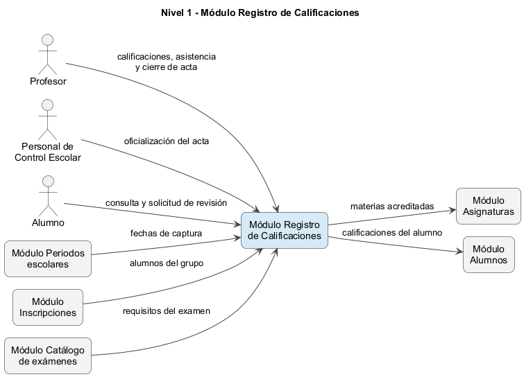

### Nivel 2

Código fuente: [e6_m8_calificaciones_contexto_nivel2.uml](../docs/architecture/diagrams/e6_m8_calificaciones_contexto_nivel2.uml)

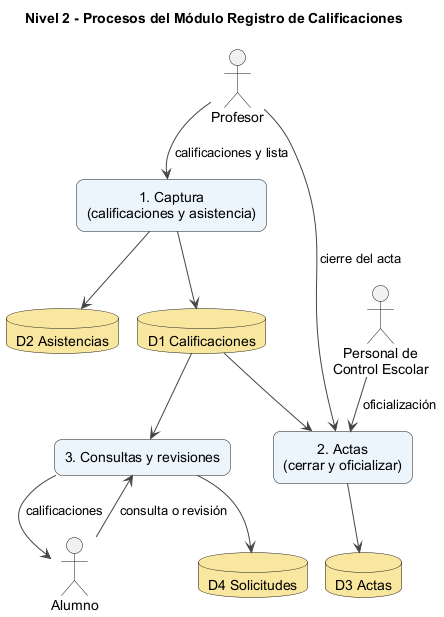

## Diagrama de componentes

Un **diagrama de componentes** muestra las piezas de software que participan en un caso de uso (pantalla, servicio, validaciones, base de datos) y con qué otros módulos se conectan. Hay uno por caso de uso. En gris aparecen los módulos de otros equipos.

### UC01 · Capturar calificaciones

Participan la pantalla de captura, el servicio de captura, el componente «Validación de fechas de captura», el Módulo Inscripciones (interfaz «Alumnos del grupo») y la base de datos.

Código fuente: [uc01_capturar_calificaciones_componentes.puml](./resources/uml/m8_calificaciones/uc01_capturar_calificaciones_componentes.puml)

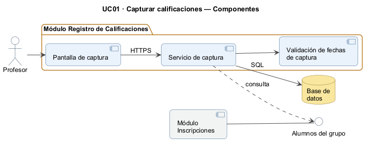

### UC02 · Registrar asistencia

Participan la pantalla de asistencia, el servicio de asistencia, el componente «Validación de fecha del periodo», el Módulo Inscripciones (interfaz «Alumnos del grupo») y la base de datos.

Código fuente: [uc02_registrar_asistencia_componentes.puml](./resources/uml/m8_calificaciones/uc02_registrar_asistencia_componentes.puml)

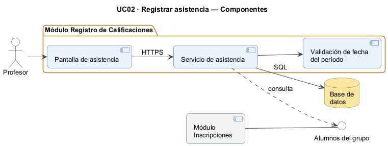

### UC03 · Cerrar acta

Participan la pantalla de actas, el servicio de actas, el componente «Generador de actas» y la base de datos.

Código fuente: [uc03_cerrar_acta_componentes.puml](./resources/uml/m8_calificaciones/uc03_cerrar_acta_componentes.puml)

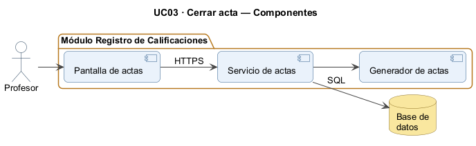

### UC04 · Oficializar acta

Participan la pantalla de actas, el servicio de actas, el Módulo Asignaturas (interfaz «Materias acreditadas») y la base de datos.

Código fuente: [uc04_oficializar_acta_componentes.puml](./resources/uml/m8_calificaciones/uc04_oficializar_acta_componentes.puml)

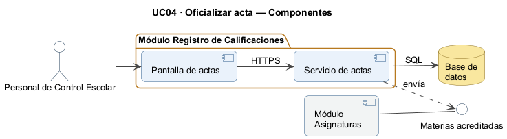

### UC05 · Consultar calificaciones

Participan la pantalla de calificaciones, el servicio de consulta, el Módulo Alumnos (interfaz «Calificaciones del alumno») y la base de datos.

Código fuente: [uc05_consultar_calificaciones_componentes.puml](./resources/uml/m8_calificaciones/uc05_consultar_calificaciones_componentes.puml)

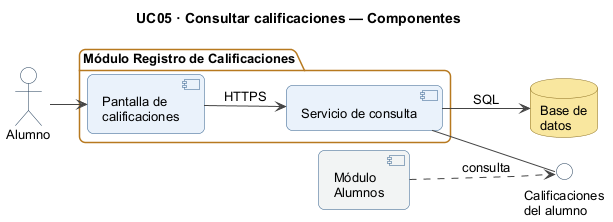

### UC06 · Solicitar revisión

Participan la pantalla de revisión, el servicio de revisión y la base de datos.

Código fuente: [uc06_solicitar_revision_componentes.puml](./resources/uml/m8_calificaciones/uc06_solicitar_revision_componentes.puml)

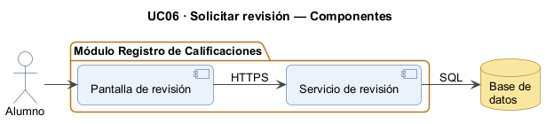

## Diagrama de secuencia

Un **diagrama de secuencia** muestra, en orden y numerados, los mensajes que se mandan el actor y las partes del sistema durante un caso de uso. El bloque `alt` separa lo que pasa cuando la validación falla de lo que pasa cuando todo sale bien. Hay uno por caso de uso.

### UC01 · Capturar calificaciones

Lo inicia: **Profesor**. Validación: ¿Está dentro de las fechas de captura? Si no se cumple, el sistema responde «La captura está cerrada para esta evaluación» y no guarda nada.

Código fuente: [uc01_capturar_calificaciones_secuencia.puml](./resources/uml/m8_calificaciones/uc01_capturar_calificaciones_secuencia.puml)

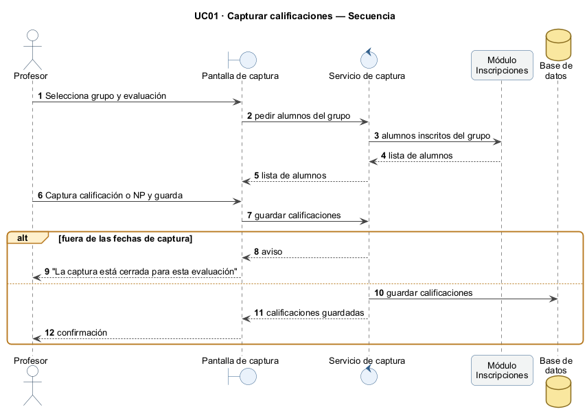

### UC02 · Registrar asistencia

Lo inicia: **Profesor**. Validación: ¿La fecha está dentro del periodo? Si no se cumple, el sistema responde «La fecha no pertenece al periodo actual» y no guarda nada.

Código fuente: [uc02_registrar_asistencia_secuencia.puml](./resources/uml/m8_calificaciones/uc02_registrar_asistencia_secuencia.puml)

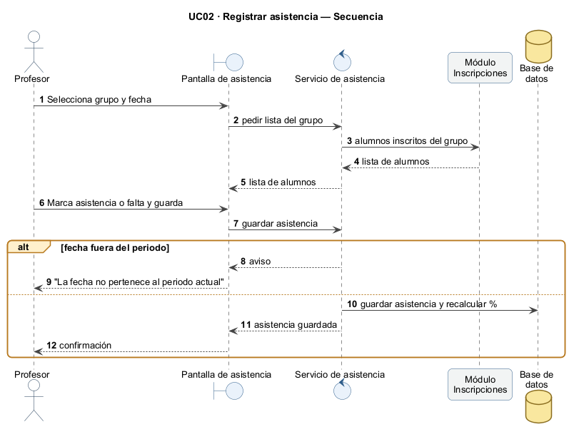

### UC03 · Cerrar acta

Lo inicia: **Profesor**. Validación: ¿Todos los alumnos tienen calificación? Si no se cumple, el sistema responde «Hay alumnos sin calificación» y no guarda nada.

Código fuente: [uc03_cerrar_acta_secuencia.puml](./resources/uml/m8_calificaciones/uc03_cerrar_acta_secuencia.puml)

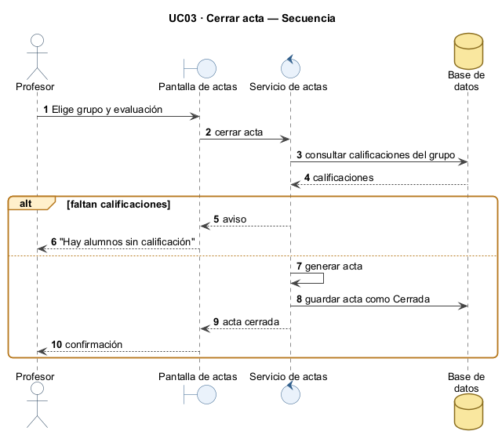

### UC04 · Oficializar acta

Lo inicia: **Personal de Control Escolar**. Validación: ¿El acta está cerrada? Si no se cumple, el sistema responde «Solo se pueden oficializar actas cerradas» y no guarda nada.

Código fuente: [uc04_oficializar_acta_secuencia.puml](./resources/uml/m8_calificaciones/uc04_oficializar_acta_secuencia.puml)

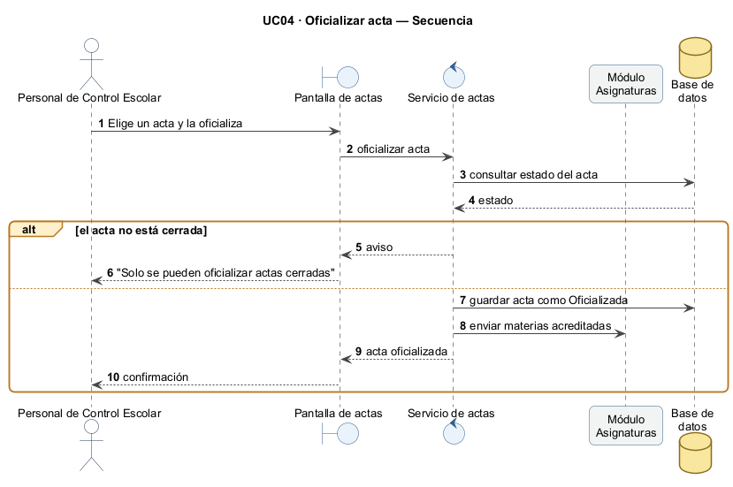

### UC05 · Consultar calificaciones

Lo inicia: **Alumno**. Validación: ¿Hay calificaciones en ese periodo? Si no se cumple, el sistema responde «Aún no hay calificaciones en ese periodo» y no guarda nada.

Código fuente: [uc05_consultar_calificaciones_secuencia.puml](./resources/uml/m8_calificaciones/uc05_consultar_calificaciones_secuencia.puml)

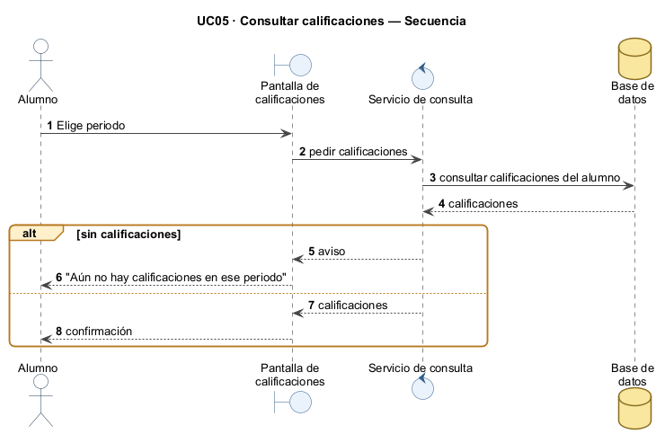

### UC06 · Solicitar revisión

Lo inicia: **Alumno**. Validación: ¿La calificación ya es oficial? Si no se cumple, el sistema responde «Solo se puede pedir revisión de calificaciones oficiales» y no guarda nada.

Código fuente: [uc06_solicitar_revision_secuencia.puml](./resources/uml/m8_calificaciones/uc06_solicitar_revision_secuencia.puml)

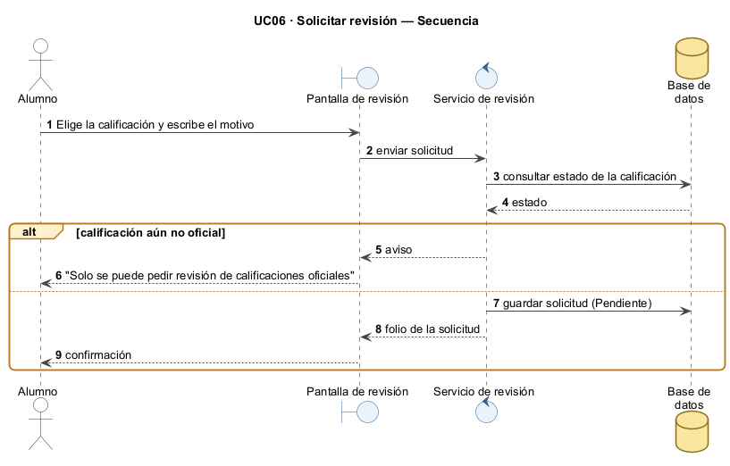

## Diagrama de actividades

Un **diagrama de actividades** muestra el flujo de trabajo de un caso de uso, paso a paso, dividido en carriles: lo que hace el actor y lo que hace el sistema. El rombo es la decisión que puede cambiar el camino. Hay uno por caso de uso.

### UC01 · Capturar calificaciones

Carriles: **Profesor** y el sistema. Decisión: ¿Está dentro de las fechas de captura? Si la respuesta es «no», el flujo termina con el aviso «La captura está cerrada para esta evaluación».

Código fuente: [uc01_capturar_calificaciones_actividades.puml](./resources/uml/m8_calificaciones/uc01_capturar_calificaciones_actividades.puml)

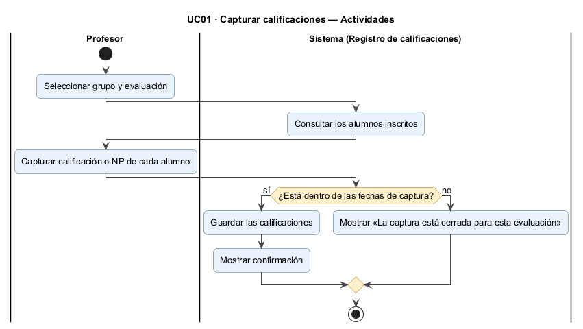

### UC02 · Registrar asistencia

Carriles: **Profesor** y el sistema. Decisión: ¿La fecha está dentro del periodo? Si la respuesta es «no», el flujo termina con el aviso «La fecha no pertenece al periodo actual».

Código fuente: [uc02_registrar_asistencia_actividades.puml](./resources/uml/m8_calificaciones/uc02_registrar_asistencia_actividades.puml)

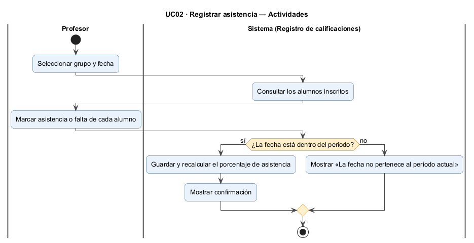

### UC03 · Cerrar acta

Carriles: **Profesor** y el sistema. Decisión: ¿Todos los alumnos tienen calificación? Si la respuesta es «no», el flujo termina con el aviso «Hay alumnos sin calificación».

Código fuente: [uc03_cerrar_acta_actividades.puml](./resources/uml/m8_calificaciones/uc03_cerrar_acta_actividades.puml)

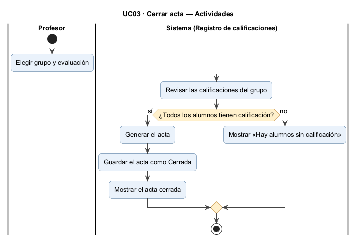

### UC04 · Oficializar acta

Carriles: **Personal de Control Escolar** y el sistema. Decisión: ¿El acta está cerrada? Si la respuesta es «no», el flujo termina con el aviso «Solo se pueden oficializar actas cerradas».

Código fuente: [uc04_oficializar_acta_actividades.puml](./resources/uml/m8_calificaciones/uc04_oficializar_acta_actividades.puml)

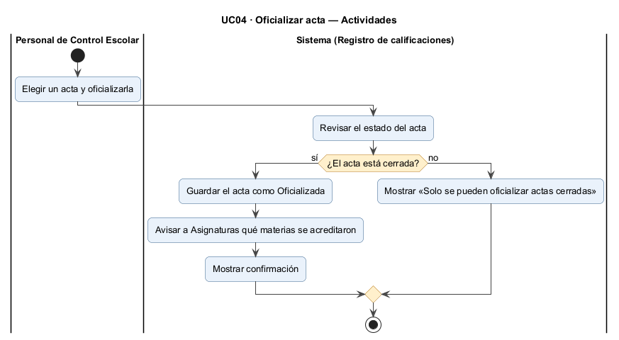

### UC05 · Consultar calificaciones

Carriles: **Alumno** y el sistema. Decisión: ¿Hay calificaciones en ese periodo? Si la respuesta es «no», el flujo termina con el aviso «Aún no hay calificaciones en ese periodo».

Código fuente: [uc05_consultar_calificaciones_actividades.puml](./resources/uml/m8_calificaciones/uc05_consultar_calificaciones_actividades.puml)

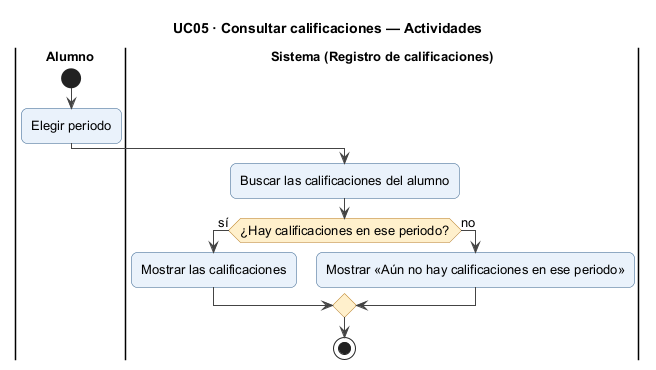

### UC06 · Solicitar revisión

Carriles: **Alumno** y el sistema. Decisión: ¿La calificación ya es oficial? Si la respuesta es «no», el flujo termina con el aviso «Solo se puede pedir revisión de calificaciones oficiales».

Código fuente: [uc06_solicitar_revision_actividades.puml](./resources/uml/m8_calificaciones/uc06_solicitar_revision_actividades.puml)

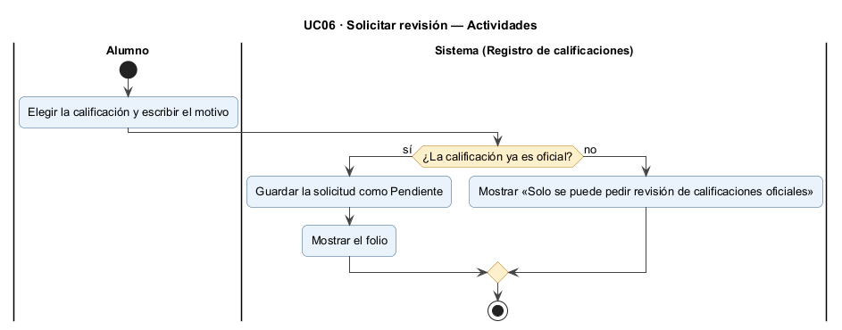

## Diagramas de estados

Un **diagrama de estados** muestra por qué situaciones pasa un objeto durante su vida y qué evento lo hace cambiar de una a otra. Entre corchetes va la condición que se debe cumplir.

### Acta de calificaciones

El acta reúne las calificaciones de un grupo. Mientras está *en captura* el profesor puede editarla; al cerrarla ya no se modifica, y Control Escolar la vuelve oficial.

Código fuente: [estados_acta.puml](./resources/uml/m8_calificaciones/estados_acta.puml)

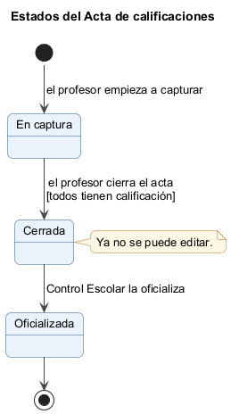

### Solicitud de revisión

Es la petición del alumno para que se revise una calificación oficial (UC06). Queda *pendiente* hasta que el profesor de la materia la abre y la responde.

Código fuente: [estados_solicitud_revision.puml](./resources/uml/m8_calificaciones/estados_solicitud_revision.puml)

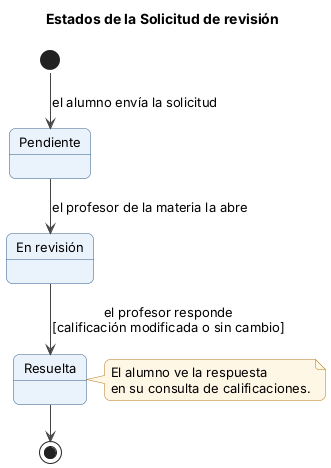

## Diagrama de clases

El profesor pidió **un solo diagrama de clases para todo el proyecto**, así que no va dentro de cada módulo. El del Equipo 6 (Registro de Calificaciones y Catálogo de Exámenes juntos, con las clases de otros módulos en gris) está en el README, sección [5.1 Diagramas UML](../README.md#51-diagramas-uml-casos-de-uso-clases-secuencia-etc).

## Dato, metadatos y reglas

El **dato** es la información principal que maneja el módulo; los **metadatos** describen cada campo de ese dato (tipo, formato, si es obligatorio) y las **reglas** son las condiciones que siempre se deben cumplir.

### Dato
**Calificación:** resultado que obtiene un alumno en una evaluación de un grupo. Puede ser un número o NP (no presentó). Las calificaciones de un grupo se juntan en un **acta**.

### Metadatos

| Campo | Descripción | Tipo | Formato o regla | Obligatorio |
|---|---|---|---|---|
| id_calificacion | Identificador interno | Entero | Autonumérico | Sí |
| id_acta | Acta a la que pertenece | Entero | — | Sí |
| id_alumno | Alumno calificado | Entero | — | Sí |
| evaluacion | Parcial, ordinario, extraordinario o título | Texto | Clave del Catálogo (ej. EX-ORD) | Sí |
| valor | Calificación | Decimal | De 0 a 10, hasta dos decimales | Si no es NP |
| es_np | No se presentó | Sí / No | — | Sí |
| porcentaje_asistencia | Asistencia del alumno | Decimal | De 0 a 100 | Sí |
| estado | Situación | Texto | En captura, Cerrada u Oficializada (igual que su acta) | Sí |
| fecha_captura | Cuándo se capturó | Fecha | AAAA-MM-DD | Sí |
| observaciones | Comentario del profesor | Texto | Hasta 250 caracteres | No |

### Reglas
1. Solo se califica a alumnos inscritos en el grupo.
2. Solo se captura dentro de las fechas que marca el módulo Periodos.
3. La calificación va de 0 a 10. Si es NP, no lleva valor y cuenta como no aprobada.
4. Para el examen final, el alumno debe tener la asistencia mínima y las oportunidades que pide el Catálogo.
5. Un acta cerrada ya no se edita y un acta oficializada no se borra.

### Modelo entidad-relación

Las tablas de este módulo están en el modelo entidad-relación del Equipo 6, junto al diagrama de clases, en el README, sección [5.1 Diagramas UML](../README.md#51-diagramas-uml-casos-de-uso-clases-secuencia-etc).

## Glosario y Abreviaturas
- **NP:** No presentó.
- **Acta de calificaciones:** Documento con las calificaciones de un grupo.
- **Oficializar:** Validación de Control Escolar que vuelve definitiva un acta.
- **Revisión:** Solicitud del alumno para que se revise una calificación.
- **Ordinario / extraordinario / título de suficiencia:** Tipos de examen definidos en el Catálogo.

## Requerimientos No funcionales
- **RNF-01:** Solo usuarios con sesión iniciada y con el rol correcto pueden capturar u oficializar.
- **RNF-02:** Las calificaciones deben coincidir con los alumnos inscritos.
- **RNF-03:** La consulta de calificaciones debe ser clara y fácil de leer.

## Relación con otros módulos
- **Periodos:** da las fechas de captura.
- **Inscripciones:** da la lista de alumnos de cada grupo.
- **Catálogo de Exámenes:** da los requisitos de cada tipo de examen.
- **Asignaturas:** recibe qué materias acreditó cada alumno.
- **Alumnos:** muestra las calificaciones que guarda este módulo.
