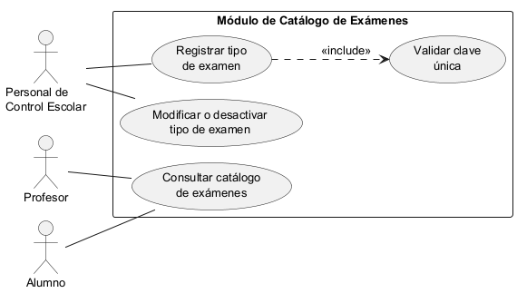

# Módulo Catálogo de Exámenes

> Equipo 6  
> **Integrantes:** Luis Fernando Guerrero Pedroza; Tendzin Angello Diaz Estrada; Erick Daniel Rosales González; Gabriell Quetzalli Santana Reyes

## Resumen
Guarda los tipos de examen (parcial, ordinario, extraordinario y título de suficiencia) y sus requisitos: asistencia mínima, calificación aprobatoria y número de oportunidades. El Calendario de Exámenes y el Registro de Calificaciones consultan esta información.

## Objetivo y Alcance
**Objetivo:** Tener en un solo lugar los tipos de examen y sus requisitos, para que todos los módulos usen las mismas reglas.

**Alcance:** Registrar, modificar, desactivar y consultar tipos de examen. No incluye fechas, horarios ni aulas.

## Requerimientos funcionales
- **RF-01:** Registrar tipos de examen con una clave única.
- **RF-02:** Guardar los requisitos de cada tipo: asistencia mínima, calificación aprobatoria y oportunidades.
- **RF-03:** Modificar o desactivar un tipo sin borrarlo.
- **RF-04:** Consultar el catálogo de exámenes.

### Relación entre requerimientos y casos de uso

Indica qué caso de uso cumple cada requerimiento funcional.

| Requerimiento | Caso de uso que lo cumple |
|---|---|
| RF-01 | UC01 Registrar tipo de examen (incluye UC04 Validar clave única) |
| RF-02 | UC01 Registrar tipo de examen y UC02 Modificar o desactivar tipo de examen |
| RF-03 | UC02 Modificar o desactivar tipo de examen |
| RF-04 | UC03 Consultar catálogo de exámenes |

## Actores

Un **actor** es quien usa el módulo desde fuera. Aquí se define quién es cada uno; lo que hace se ve en el diagrama de casos de uso.

| Actor | ¿Quién es? | Rol en el diagrama de herencia |
|---|---|---|
| Personal de Control Escolar | Empleado del área de Control Escolar de la Facultad, responsable de los registros oficiales de los alumnos. | AdministradorEscolar |
| Profesor | Docente de la Facultad que tiene asignado al menos un grupo en el periodo actual (registrado en el módulo Profesores). | Profesor |
| Alumno | Estudiante de la Facultad inscrito en al menos un grupo del periodo actual (registrado en el módulo Alumnos). | Alumno |

## Diagrama de casos de uso

Un **diagrama de casos de uso** muestra qué puede hacer cada actor en el módulo. Cada óvalo es un caso de uso; `<<include>>` indica un paso que siempre se ejecuta dentro de otro caso.

Código fuente: [casos_uso.puml](./resources/uml/m9_catalogo_examenes/casos_uso.puml)

| ID | Caso de uso | Actor | Descripción |
|---|---|---|---|
| UC01 | Registrar tipo de examen | Personal de Control Escolar | Da de alta un tipo con sus requisitos. |
| UC02 | Modificar o desactivar tipo de examen | Personal de Control Escolar | Cambia datos o desactiva un tipo. |
| UC03 | Consultar catálogo de exámenes | Profesor, Alumno | Muestra los tipos activos y sus requisitos. |

UC04 (Validar clave única) se incluye dentro de UC01.

### Precondiciones y postcondiciones

La **precondición** es lo que debe ser cierto antes de empezar el caso de uso; la **postcondición** es cómo queda el sistema cuando termina bien.

| Caso | Precondición | Postcondición |
|---|---|---|
| UC01 | El personal de Control Escolar inició sesión. | El tipo de examen queda *Activo* con sus requisitos. |
| UC02 | El tipo de examen ya existe en el catálogo. | Los cambios quedan guardados o el tipo queda *Inactivo*; nunca se borra. |
| UC03 | El usuario inició sesión. | Se muestran los tipos activos y sus requisitos; no se modifica nada. |

## Diagramas de contexto

Los **diagramas de contexto** ubican al módulo dentro del sistema de Control Escolar. El nivel 1 muestra con qué actores y módulos intercambia información; el nivel 2 abre el módulo y muestra sus partes internas.

### Nivel 1

Código fuente: [e6_m9_catalogo_examenes_contexto_nivel1.uml](../docs/architecture/diagrams/e6_m9_catalogo_examenes_contexto_nivel1.uml)

### Nivel 2

Código fuente: [e6_m9_catalogo_examenes_contexto_nivel2.uml](../docs/architecture/diagrams/e6_m9_catalogo_examenes_contexto_nivel2.uml)

## Diagrama de componentes

Un **diagrama de componentes** muestra las piezas de software que participan en un caso de uso (pantalla, servicio, validaciones, base de datos) y con qué otros módulos se conectan. Hay uno por caso de uso. En gris aparecen los módulos de otros equipos.

### UC01 · Registrar tipo de examen

Participan la formulario de tipo de examen, el servicio de catálogo, el componente «Validación de clave única» y la base de datos.

Código fuente: [uc01_registrar_tipo_componentes.puml](./resources/uml/m9_catalogo_examenes/uc01_registrar_tipo_componentes.puml)

### UC02 · Modificar o desactivar tipo de examen

Participan la formulario de tipo de examen, el servicio de catálogo, el Módulo Calendario de exámenes (interfaz «Exámenes programados») y la base de datos.

Código fuente: [uc02_modificar_desactivar_tipo_componentes.puml](./resources/uml/m9_catalogo_examenes/uc02_modificar_desactivar_tipo_componentes.puml)

### UC03 · Consultar catálogo de exámenes

Participan la pantalla del catálogo, el servicio de catálogo, el Módulo Registro de calificaciones (interfaz «Tipos y requisitos») y la base de datos.

Código fuente: [uc03_consultar_catalogo_componentes.puml](./resources/uml/m9_catalogo_examenes/uc03_consultar_catalogo_componentes.puml)

## Diagrama de secuencia

Un **diagrama de secuencia** muestra, en orden y numerados, los mensajes que se mandan el actor y las partes del sistema durante un caso de uso. El bloque `alt` separa lo que pasa cuando la validación falla de lo que pasa cuando todo sale bien. Hay uno por caso de uso.

### UC01 · Registrar tipo de examen

Lo inicia: **Personal de Control Escolar**. Validación: ¿La clave es nueva? Si no se cumple, el sistema responde «Ya existe un tipo con esa clave» y no guarda nada.

Código fuente: [uc01_registrar_tipo_secuencia.puml](./resources/uml/m9_catalogo_examenes/uc01_registrar_tipo_secuencia.puml)

### UC02 · Modificar o desactivar tipo de examen

Lo inicia: **Personal de Control Escolar**. Validación: ¿No tiene exámenes programados? Si no se cumple, el sistema responde «El tipo tiene exámenes programados; inténtalo cuando se apliquen» y no guarda nada.

Código fuente: [uc02_modificar_desactivar_tipo_secuencia.puml](./resources/uml/m9_catalogo_examenes/uc02_modificar_desactivar_tipo_secuencia.puml)

### UC03 · Consultar catálogo de exámenes

Lo inicia: **Profesor / Alumno**. Validación: ¿Hay tipos activos? Si no se cumple, el sistema responde «No hay tipos de examen registrados» y no guarda nada.

Código fuente: [uc03_consultar_catalogo_secuencia.puml](./resources/uml/m9_catalogo_examenes/uc03_consultar_catalogo_secuencia.puml)

## Diagrama de actividades

Un **diagrama de actividades** muestra el flujo de trabajo de un caso de uso, paso a paso, dividido en carriles: lo que hace el actor y lo que hace el sistema. El rombo es la decisión que puede cambiar el camino. Hay uno por caso de uso.

### UC01 · Registrar tipo de examen

Carriles: **Personal de Control Escolar** y el sistema. Decisión: ¿La clave es nueva? Si la respuesta es «no», el flujo termina con el aviso «Ya existe un tipo con esa clave».

Código fuente: [uc01_registrar_tipo_actividades.puml](./resources/uml/m9_catalogo_examenes/uc01_registrar_tipo_actividades.puml)

### UC02 · Modificar o desactivar tipo de examen

Carriles: **Personal de Control Escolar** y el sistema. Decisión: ¿No tiene exámenes programados? Si la respuesta es «no», el flujo termina con el aviso «El tipo tiene exámenes programados; inténtalo cuando se apliquen».

Código fuente: [uc02_modificar_desactivar_tipo_actividades.puml](./resources/uml/m9_catalogo_examenes/uc02_modificar_desactivar_tipo_actividades.puml)

### UC03 · Consultar catálogo de exámenes

Carriles: **Profesor / Alumno** y el sistema. Decisión: ¿Hay tipos activos? Si la respuesta es «no», el flujo termina con el aviso «No hay tipos de examen registrados».

Código fuente: [uc03_consultar_catalogo_actividades.puml](./resources/uml/m9_catalogo_examenes/uc03_consultar_catalogo_actividades.puml)

## Diagramas de estados

Un **diagrama de estados** muestra por qué situaciones pasa un objeto durante su vida y qué evento lo hace cambiar de una a otra. Entre corchetes va la condición que se debe cumplir.

### Tipo de examen

Un tipo de examen nunca se borra: se desactiva para que deje de usarse y se puede volver a activar.

Código fuente: [estados_tipo_examen.puml](./resources/uml/m9_catalogo_examenes/estados_tipo_examen.puml)

### Requisitos del tipo de examen

Los requisitos (asistencia mínima, calificación aprobatoria y oportunidades) se pueden cambiar mientras no haya exámenes programados con ese tipo; cuando el Calendario programa uno, quedan bloqueados para no cambiar las reglas a mitad del periodo (ver UC02).

Código fuente: [estados_requisitos.puml](./resources/uml/m9_catalogo_examenes/estados_requisitos.puml)

## Diagrama de clases

El profesor pidió **un solo diagrama de clases para todo el proyecto**, así que no va dentro de cada módulo. El del Equipo 6 (Registro de Calificaciones y Catálogo de Exámenes juntos, con las clases de otros módulos en gris) está en el README, sección [5.1 Diagramas UML](../README.md#51-diagramas-uml-casos-de-uso-clases-secuencia-etc).

## Dato, metadatos y reglas

El **dato** es la información principal que maneja el módulo; los **metadatos** describen cada campo de ese dato (tipo, formato, si es obligatorio) y las **reglas** son las condiciones que siempre se deben cumplir.

### Dato
**Tipo de examen:** clase de evaluación que existe en la escuela, junto con lo que se necesita para presentarla y aprobarla.

### Metadatos

| Campo | Descripción | Tipo | Formato o regla | Obligatorio |
|---|---|---|---|---|
| id_tipo_examen | Identificador interno | Entero | Autonumérico | Sí |
| clave | Clave visible | Texto | 3 a 10 caracteres en mayúsculas (ej. EX-ORD), única | Sí |
| nombre | Nombre del tipo | Texto | Hasta 60 caracteres | Sí |
| descripcion | Para qué sirve | Texto | Hasta 250 caracteres | No |
| asistencia_minima | Asistencia para poder presentar | Decimal | De 0 a 100 % | Sí |
| calificacion_aprobatoria | Mínimo para aprobar | Decimal | De 0 a 10 | Sí |
| oportunidades | Veces que se puede presentar | Entero | 1 o más | Sí |
| estado | Disponibilidad | Texto | Activo o Inactivo | Sí |
| fecha_alta | Cuándo se registró | Fecha | AAAA-MM-DD | Sí |
| registrado_por | Quién lo registró | Entero | Usuario de Control Escolar | Sí |

### Tipos iniciales
Son las mismas claves que usa el módulo Calendario de Exámenes.

| Clave | Nombre |
|---|---|
| EX-PAR | Examen parcial |
| EX-ORD | Examen ordinario |
| EX-EXT | Examen extraordinario |
| EX-TS | Examen a título de suficiencia |

### Reglas
1. La clave no se puede repetir.
2. La asistencia mínima va de 0 a 100 %, la calificación aprobatoria de 0 a 10 y debe haber al menos una oportunidad.
3. Un tipo de examen no se borra: se desactiva.
4. No se puede desactivar un tipo que tenga exámenes programados en el Calendario.
5. Calendario y Registro de Calificaciones solo usan tipos activos.

### Modelo entidad-relación

La tabla `tipo_examen` de este módulo están en el modelo entidad-relación del Equipo 6, junto al diagrama de clases, en el README, sección [5.1 Diagramas UML](../README.md#51-diagramas-uml-casos-de-uso-clases-secuencia-etc).

## Glosario y Abreviaturas
- **Tipo de examen:** Clase de evaluación (parcial, ordinario, extraordinario o título de suficiencia).
- **Requisito:** Condición para presentar o aprobar un examen.
- **Oportunidad:** Cada vez que el alumno puede presentar un examen.

## Requerimientos No funcionales
- **RNF-01:** Solo Control Escolar puede modificar el catálogo.
- **RNF-02:** Los tipos de examen nunca se borran, para no perder el historial.
- **RNF-03:** La información del catálogo debe ser la misma para todos los módulos que la consultan.

## Relación con otros módulos
- **Calendario de Exámenes:** usa los tipos de examen para programar y avisa si un tipo tiene exámenes pendientes.
- **Registro de Calificaciones:** usa los requisitos para saber quién puede presentar y quién aprueba.
